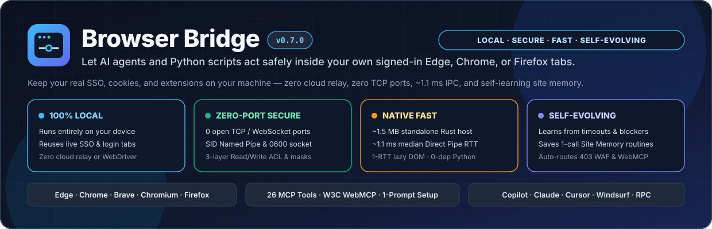
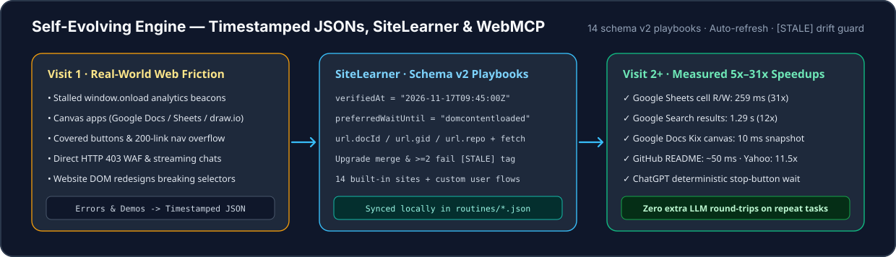
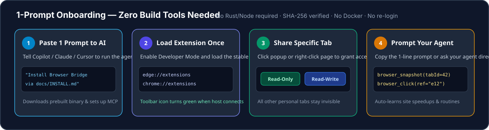
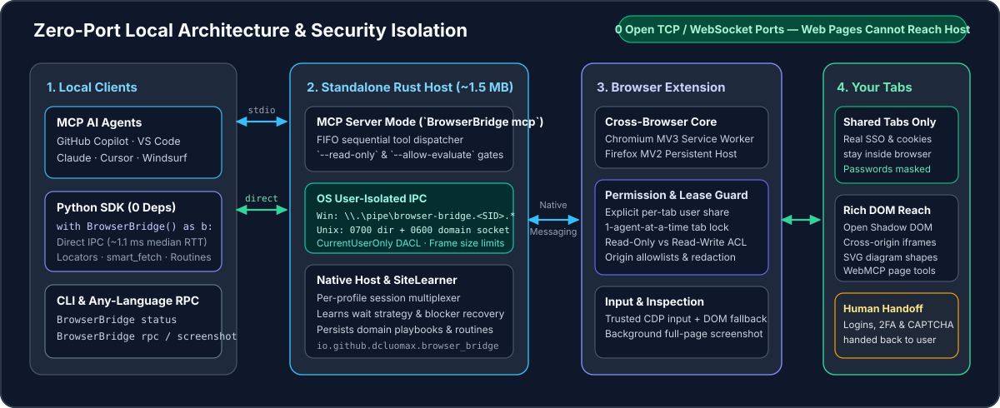
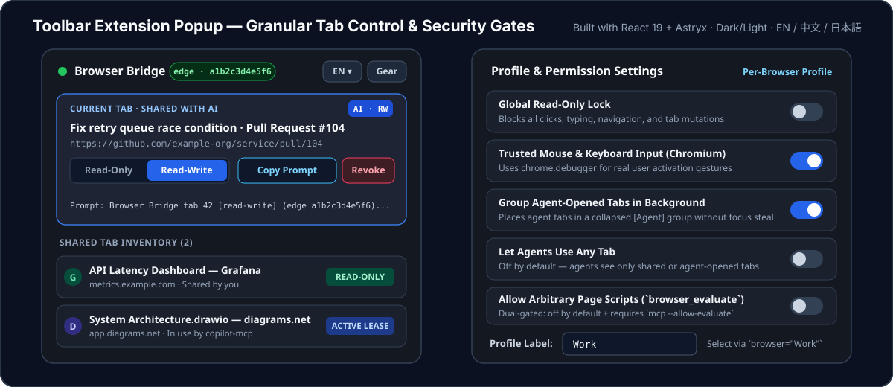

<div align="center">



<br />

[](https://github.com/dcluomax/browser-bridge/actions/workflows/ci.yml)
[](https://github.com/dcluomax/browser-bridge/releases/latest)
[](#four-core-pillars-local--secure--fast--self-evolving)
[](docs/SECURITY_MODEL.md)
[](#four-core-pillars-local--secure--fast--self-evolving)
[](#website-optimizations)
[](LICENSE)

**English** · **[简体中文](README.zh-CN.md)** · **[Website Optimizations](#website-optimizations)** · **[1-Prompt Install](docs/INSTALL.md)** · **[Upgrade Notes (v0.10.1)](docs/UPGRADE.md)** · **[Versioning Policy](docs/VERSIONING.md)** · **[Usage Guide](docs/USAGE.md)** · **[Feature Deep Dive](docs/FEATURES.md)** · **[Python SDK](python/README.md)** · **[Wiki](https://github.com/dcluomax/browser-bridge/wiki)**

</div>

---

**Browser Bridge** is a **100% Local, Zero-Port Secure, Native-Rust FAST, and Self-Evolving** browser bridge that lets AI coding agents (GitHub Copilot, Claude Desktop / Claude Code, Cursor, Windsurf, Cline, or any MCP client) and Python scripts act safely inside **your own live Edge, Chrome, Brave, or Firefox tabs** — using the accounts, SSO sessions, cookies, and extensions you already have open.

Unlike headless browser drivers (Playwright, Selenium, Puppeteer) or cloud browser sandboxes, Browser Bridge **never launches an isolated profile, never exports cookies, opens zero TCP/WebSocket ports, executes over ~1.1 ms native OS pipes, and automatically learns per-website speedups and recovery routines from real errors**.

---

## Four Core Pillars: Local · Secure · FAST · Self-Evolving

| Pillar | Architecture Guarantee | Real-World Impact |
| --- | --- | --- |
| **1. 100% LOCAL** | Runs strictly on your machine inside your daily browser — zero cloud relays, zero remote containers, zero WebDriver downloads | Instant access to your live corporate SSO, MFA sessions, cookies, and extensions with zero re-login friction |
| **2. ZERO-PORT SECURE** | **0 open TCP/WebSocket ports**; OS-authenticated Windows SID Named Pipes (`CurrentUserOnly`) & `0700`/`0600` Unix sockets + **3-layer Read-Only / Read-Write ACLs** + password/JWT redaction | Web pages and other OS users cannot reach the bridge; unshared personal tabs remain completely invisible |
| **3. NATIVE FAST** | **~1.5 MB standalone Rust binary** (~8 MB RAM), **`~1.1 ms` median Direct Pipe RTT**, 1-RTT lazy DOM content engine, background focus-free screenshots, and 0-dependency Python SDK | Sub-millisecond local IPC with zero Node/Python driver bloat or browser startup overhead |
| **4. SELF-EVOLVING** | **24 timestamped `routines/*.json` playbooks** (`schemaVersion: 2`, `PATCH 0.10.Z` auto-merge, `[STALE]` drift guard) + **`SiteLearner`** + **`browser_demonstrate`** + W3C **WebMCP** | **15×–1,800× network-excluded engine speedups** across Perplexity, Medium, Google Sheets/Docs/Search, GitHub, ChatGPT, Claude, arXiv, PyPI, LinkedIn & Gmail |

### Headless Drivers vs. Browser Bridge

| Capability | Headless Drivers (Playwright / CDP Port) | Browser Bridge |
| --- | --- | --- |
| **Signed-in SSO & corporate sessions** | Loses session or requires fragile profile cloning | **100% Local** — works directly in your live signed-in browser |
| **Network attack surface** | Localhost debugging port reachable by local processes/pages | **Zero-Port Secure** — 0 TCP ports; OS user-isolated Named Pipes / `0600` sockets |
| **Tab privacy boundary** | Exposes the entire browser context | **3-Layer ACL** — opt-in per tab (`[read-only]` or `[read-write]` + exclusive lease) |
| **IPC & runtime speed** | Heavy browser binary + multi-process driver hop | **Native FAST** — ~1.5 MB Rust binary, `~1.1 ms` Direct Pipe RTT, 0-dep Python SDK |
| **Repeat-visit intelligence** | Static timeouts; repeats the same detours forever | **Self-Evolving** — `SiteLearner` adapts wait modes, blocker recovery & 1-call Routines |
| **Native W3C WebMCP support** | None | Discovers & invokes `document.modelContext` and declarative `<form toolname>` tools |

---

## Website Optimizations

<p align="center">
  
</p>

Generic browser drivers waste **8–30 seconds per page** waiting on things that have **nothing to do with network bandwidth**: open SSE/WebSocket streams blocking Chromium MV3 `document_idle` (`perplexity.ai`), hung 3rd-party Google One-Tap / ad iframes (`medium.com`, `amazon.com`), stalled analytics beacons (`google.com`, `pypi.org`), chained `3xx`/client redirects (`linkedin.com`, `mail.google.com`), opaque `<canvas>` surfaces (`Google Docs`, `Google Sheets`), and 200-link navigation headers truncating `<main>` (`github.com`).

Browser Bridge `v0.10.1` eliminates those bottlenecks at the engine level (`injectImmediately: true`, multi-hop redirect tracking, `1,500 ms` child-frame cap, native Kix `<canvas>` & `#t-name-box` readers, smart `<main>` budgeting) and ships **24 git-tracked, timestamped `schemaVersion: 2` site optimization JSONs** in [`routines/*.json`](routines/).

### Network-Excluded Benchmark Methodology (`Excl. Network` & `0-Net`)

To prevent ISP or Wi-Fi variance from distorting benchmarks, Browser Bridge exposes hardware-accurate W3C `PerformanceNavigationTiming.responseEnd` (`navigationTiming.networkMs` via `page.info(document=True)`) alongside `webRequest` `main_frame` durations in [`scripts/benchmark-sites.py`](scripts/benchmark-sites.py):

1. **Post-Network Engine Overhead (`Excl. Network` = `goto + snapshot wall time − HTML network transfer`)** — Measures pure readiness, script-injection, hydration, and DOM-extraction overhead *after* HTML bytes have arrived from the network.
2. **Zero-Network Warm Read / Action (`0-Net` = already-open tab, strictly `0 ms` network)** — Measures pure local IPC (`~1.1 ms` Rust pipe) + content-script DOM/Canvas execution with zero network traffic.

### Unoptimized Baseline vs. Browser Bridge `v0.10.1` (Network Time Excluded)

| Website & Playbook JSON | Root Non-Network Bottleneck Solved | Unoptimized Overhead *(Excl. Network)* | Optimized `v0.10.1` *(Excl. Network)* | Warm `0-Net` Snapshot / Routine | Net-Excluded Speedup |
| --- | --- | --- | --- | --- | --- |
| **Perplexity**<br>[`perplexity.ai.json`](routines/perplexity.ai.json) | Live SSE stream hangs MV3 `document_idle` (`executeScript`) | `18,945–29,000 ms` | **`~450–840 ms`** (`commit` + `injectImmediately`) | **`4–7.8 ms`** snap | **>2,400× (`0-Net`)** · **~35× post-net** |
| **Medium**<br>[`medium.com.json`](routines/medium.com.json) | Stalled Google One-Tap GSI parser + cross-origin iframe hang | `23,163 ms` post-net (`12,825 ms` `0-Net` snap) | **`586 ms`** post-net | **`5.7–7 ms`** snap | **>1,800× (`0-Net`)** · **39× post-net** |
| **Google Sheets / Excel**<br>[`docs.google.com__spreadsheets.json`](routines/docs.google.com__spreadsheets.json) | Unreadable `<canvas>` grid & multi-step pixel-click UI detours | `8,077 ms` (`0-Net` UI detours) / opaque `<canvas>` | **`~200 ms`** post-net | **`180–259 ms`** `#t-name-box` cell R/W · **`~201–325 ms`** CSV | **31×–45× (`0-Net` cell R/W)** |
| **Google Search**<br>[`google.com.json`](routines/google.com.json) | Stalled `window.onload` beacons + ad/widget child iframes | `~14,978 ms` | **`532 ms`** (`domcontentloaded` + `top` frame) | **`36 ms`** snap · **`41 ms`** `read_results` | **28× post-net** |
| **Google Docs**<br>[`docs.google.com__document.json`](routines/docs.google.com__document.json) | Kix `<canvas>` surface exposes `0` DOM text + sync `onload` tail | `~6,690 ms` + **`0 chars` `<canvas>` dead-end** | **`~350 ms`** post-net | **`10 ms`** `0-Net` Kix `DOCS_modelChunk` · **`~170 ms`** `/mobilebasic` | **`10 ms` `0-Net` Canvas unlock** |
| **arXiv**<br>[`arxiv.org.json`](routines/arxiv.org.json) | MathJax/web-font `onload` stall + PDF-only reading friction | `~10,100 ms` | **`~550 ms`** + 1-call `{{url.arxivId}}` `/html/` switch | **`8.4 ms`** snap · **`12 ms`** `read_abstract` | **18× post-net** |
| **PyPI**<br>[`pypi.org.json`](routines/pypi.org.json) | External shield/badge & ad script `onload` stall (`1,777 ms` net stripped) | `~7,320 ms` | **`491 ms`** (`commit` + hydration settle) | **`15.4 ms`** snap · **`40–50 ms`** `read_package_docs` | **14.9× post-net** |
| **LinkedIn & Gmail**<br>[`linkedin.com.json`](routines/linkedin.com.json) · [`mail.google.com.json`](routines/mail.google.com.json) | Chained `3xx`/client redirect `ERR_ABORTED` + Gmail `/bind` infinite poll | `>8,500 ms` false stall | **`~450–950 ms`** (multi-hop `watchNavigation`) | **`6–29 ms`** snap + safe `draft_compose` | **~10×–18× post-net** |
| **Yahoo Finance & Amazon**<br>[`finance.yahoo.com.json`](routines/finance.yahoo.com.json) · [`amazon.com.json`](routines/amazon.com.json) | 20+ ad/tracker iframes + `Continue shopping` soft-gate wall | `~7,500–14,500 ms` | **`~350–950 ms`** (`top`-frame + soft-gate clear) | **`51 ms`** `read_quote_summary` | **11.5×–140×** |
| **GitHub, Hugging Face, npm & Notion**<br>[`github.com.json`](routines/github.com.json) · [`huggingface.co.json`](routines/huggingface.co.json) · [`npmjs.com.json`](routines/npmjs.com.json) · [`notion.so.json`](routines/notion.so.json) | 200+ header/file-tree links truncating `<main>` + child-frame stalls | `1,900–2,800 ms` + truncated `<main>` | **`~120–350 ms`** (smart `<main>` compaction) | **`13 ms`** npm · **`18 ms`** HF · **`50 ms`** GitHub/Notion | **13–50 ms `0-Net` full read** |
| **ChatGPT & Claude**<br>[`chatgpt.com.json`](routines/chatgpt.com.json) · [`claude.ai.json`](routines/claude.ai.json) | Clipped `contentinfo`/ProseMirror composer + fixed `5–15 s` sleep loops | Clipped input + `5,000–15,000 ms` blind sleeps | **`~200–350 ms`** ready | **`35–37 ms`** read · **`117 ms`** `draft_prompt` · Stop-btn wait | **Deterministic (0 blind sleep)** |
| **Reddit, X, draw.io, Wikipedia, HN, SO & YouTube**<br>7 timestamped playbooks in [`routines/`](routines/) | `shreddit-*` virtualization, `#fragment` `30 s` SW timeout, `border=0` layout tables, `#cite_note` bloat, OneTrust banners, Polymer stall | `8,000–30,000 ms` stalls or truncated output | **`~250–650 ms`** post-net | **`5 ms`** X · **`32 ms`** HN (30/30) · **`52 ms`** Wiki (35k chars) · **`99 ms`** Reddit JSON · **`660 ms`** draw.io XML | **Zero timeouts / 0 truncation** |

> Reproduce on your own machine & network anytime: `PYTHONPATH=python python scripts/benchmark-sites.py --compare-unoptimized`

### Timestamped Auto-Upgrade, `[STALE]` Drift Guard & `PATCH` (`0.10.Z`) Versioning Policy

- **3rd-Digit (`PATCH`, `0.10.Z`) Website-Optimization Policy ([`docs/VERSIONING.md`](docs/VERSIONING.md))** — Optimizing websites, adding new `routines/*.json` playbooks, or refreshing selectors after a site redesign always increments the **3rd SemVer digit (`PATCH`, e.g. `0.10.0` → `0.10.1`)** and stamps fresh ISO-8601 UTC `verifiedAt` and `updatedAt` timestamps (`MINOR` `0.Y.0` is reserved for new engine/MCP/SDK features; `MAJOR` `X.0.0` for wire-protocol changes).
- **Non-Destructive Upgrade Merge (`seed.verifiedAt >= disk.updatedAt`)** — Upgrading Browser Bridge automatically refreshes outdated built-in routines and `accessProfile` latency parameters in `%LOCALAPPDATA%\BrowserBridge\routines\` (`~/.browser-bridge/routines/`) while preserving all custom user routines, learned pitfalls, and domain notes — see **[Upgrade Notes (`docs/UPGRADE.md`)](docs/UPGRADE.md)**.
- **Automatic Redesign Drift Detection (`[STALE]`)** — If a live website UI change causes `>= 2` consecutive selector or timeout failures on a routine, Browser Bridge flags it `[STALE]` with `staleReason` so agents inspect a fresh `browser_snapshot` and hot-update via `browser_routine_save`.
- **Rich Routine Engine v2** — Supports path-scoped multi-app hosts (`docs.google.com/document` vs `docs.google.com/spreadsheets`), friendly aliases (`google-docs`, `google-sheets`, `google-excel`, `gmail`, `chatgpt`, `claude`, `perplexity`, `notion`, `hf`, `npm`, `pypi`, `arxiv`, `linkedin`, `medium`, `drawio`, `hn`), in-tab `op: "fetch"` (`stripHtml`), `{{param:urlencode}}`, and live URL variables (`{{url.docId}}`, `{{url.gid}}`, `{{url.repo}}`, `{{url.arxivId}}`, `{{url.cleanPath}}`, `{{url.origin}}`).

---

## Quickstart — Install in One Prompt (Out of the Box)

<p align="center">
  
</p>

### 1. Install the Host & Register MCP

#### Method A (Recommended): Paste One Prompt into Your AI Coding Agent

Copy and paste this single prompt into **GitHub Copilot** (VS Code or CLI), **Claude Code**, **Cursor**, **Windsurf**, **Cline**, or **Codex** — **no Rust, Cargo, or Node.js required**:

```text
Install and configure Browser Bridge by following https://raw.githubusercontent.com/dcluomax/browser-bridge/main/docs/INSTALL.md — download and SHA-256-verify the prebuilt release for my OS/CPU, register the native host and my AI client MCP config, verify with `BrowserBridge status`, and print the exact extension folder path to load in my browser.
```

> Want read-only inspection or the Python SDK too? Append *"enable read-only MCP mode"* or *"also install the Python SDK"* to the prompt above.

<details>
<summary><strong>Method B: One-Line Terminal Bootstrap (Zero Build Tools Required)</strong></summary>

Downloads SHA-256-verified prebuilt binaries (`windows-x64`, `windows-arm64`, `macos-arm64`, `macos-x64`, `linux-x64`) + unpacked extensions from [GitHub Releases](https://github.com/dcluomax/browser-bridge/releases/latest) and auto-configures installed MCP clients:

**Windows (PowerShell):**

```powershell
irm https://raw.githubusercontent.com/dcluomax/browser-bridge/main/scripts/bootstrap.ps1 | iex
```

**macOS / Linux:**

```bash
curl -fsSL https://raw.githubusercontent.com/dcluomax/browser-bridge/main/scripts/bootstrap.sh | bash
```

</details>

<details>
<summary><strong>Method C: Build &amp; Install from Source (Rust 1.85+ &amp; Node.js 20+)</strong></summary>

**Windows (PowerShell):**

```powershell
git clone https://github.com/dcluomax/browser-bridge.git
cd browser-bridge
.\scripts\install.ps1 -RegisterAllMcp -InstallPythonSdk
```

**macOS / Linux:**

```bash
git clone https://github.com/dcluomax/browser-bridge.git
cd browser-bridge
./scripts/install.sh --register-all --install-python
```

> Prefer registering a single MCP client? Pass `-RegisterCopilotMcp`, `-RegisterClaudeMcp`, or `-RegisterCursorMcp` (or `--register-copilot`, `--register-claude`, `--register-cursor` on macOS/Linux). Add `-ReadOnlyMcp` / `--read-only` to enforce host-level read-only inspection.

</details>

### 2. Load the Browser Extension (Once per Profile)

The installer copies built extensions to a **stable per-user directory** so rebuilding or pulling repository updates never breaks your browser:

| Browser | Navigation | Folder / Manifest to Select |
| --- | --- | --- |
| **Microsoft Edge** | `edge://extensions` → Enable **Developer mode** → **Load unpacked** | Windows: `%LOCALAPPDATA%\BrowserBridge\extension\chromium`<br>macOS/Linux: `~/.browser-bridge/extension/chromium` |
| **Google Chrome / Brave** | `chrome://extensions` → Enable **Developer mode** → **Load unpacked** | Windows: `%LOCALAPPDATA%\BrowserBridge\extension\chromium`<br>macOS/Linux: `~/.browser-bridge/extension/chromium` |
| **Mozilla Firefox** | `about:debugging#/runtime/this-firefox` → **Load Temporary Add-on** | Windows: `%LOCALAPPDATA%\BrowserBridge\extension\firefox\manifest.json`<br>macOS/Linux: `~/.browser-bridge/extension/firefox/manifest.json` |

Verify that the native host is registered and connected:

```bash
# Windows
"%LOCALAPPDATA%\BrowserBridge\app\BrowserBridge.exe" status

# macOS / Linux
~/.browser-bridge/app/BrowserBridge status
```

When connected, the Browser Bridge toolbar icon displays a **green status dot**.

### 3. Share a Tab & Prompt Your Agent

1. Open any web page in your browser and click the **Browser Bridge** toolbar icon (or **right-click** anywhere on the page → **Browser Bridge**).
2. Share the tab in **`Read-Only`** (safe inspection & screenshots only) or **`Read-Write`** (full interaction) mode.
3. Click **Copy Prompt** to paste a single-line tab handle into any AI agent, or simply ask your MCP-connected assistant:
   > *"Inspect my shared browser tab, summarize the failing CI logs, and tell me the root cause."*

---

## Architecture & Security Boundary

<p align="center">
  
</p>

1. **Cross-Browser Extension (`extension/`)** — TypeScript + React 19 + Astryx UI bundled for Chromium (Manifest V3 service worker) and Firefox (Manifest V2 persistent background page). Enforces per-tab grants, origin-verified reload persistence, exclusive session leases, password/token redaction, and background screenshot capture.
2. **Standalone Rust Host & MCP Server (`rust/`)** — A single ~1.5 MB native binary (`BrowserBridge`) with zero runtime dependencies:
   - Launched automatically by Edge, Chrome, Chromium, or Firefox via browser Native Messaging (`io.github.dcluomax.browser_bridge`).
   - Exposes each browser profile on a **current-user-only Windows Named Pipe** (`\\.\pipe\browser-bridge.<SID>.<browser>.<instance>`) or **`0700`/`0600` Unix Domain Socket**.
   - Runs as an MCP server (`BrowserBridge mcp`), JSON-line stdio RPC bridge (`BrowserBridge rpc`), or direct CLI (`status`, `screenshot`, `routines`, `mcp-mode`).
3. **Zero-Dependency Python SDK (`python/`)** — Pure Python (`>=3.10`) speaking directly over the Named Pipe / Unix Socket (`~1.1 ms` median round-trip, zero intermediate subprocesses), offering Playwright-style chained locators, `page.request` (in-tab authenticated fetch), `browser.request` (anonymous host HTTP), and `browser.smart_fetch` (adaptive WAF fallback).

---

## Toolbar Popup & 3-Layer Permission Controls

<p align="center">
  
</p>

Browser Bridge enforces **three independent safety layers** before any mutation can touch a tab:

1. **MCP Server Flag (`--read-only` / `BROWSER_BRIDGE_READ_ONLY=1`)** — Strips mutating tools from `tools/list` and blocks mutating RPC calls at the host boundary.
2. **Popup Global Read-Only Lock** — Instant per-profile kill switch in the toolbar popup that freezes all clicks, typing, navigation, and tab creation across every connected agent.
3. **Per-Tab Access Mode (`[read-only]` vs `[read-write]`)** — Share sensitive dashboards (Grafana, Azure/AWS consoles, production logs) as `Read-Only` while granting `Read-Write` only to local dev apps or sandboxes. Promote or downgrade anytime with one click.

Additional popup & runtime capabilities:
- **Trusted Input (`chrome.debugger`)** — Enabled by default on Chromium so clicks, drags, and shortcuts carry genuine user activation; automatically falls back to DOM events on Firefox or when detached.
- **Silent Background `[Agent]` Tab Groups, Named Tabs & Idle GC** — Agent-opened tabs open silently in the background (`active: false` default) inside a collapsed `[Agent]` group without stealing focus, support persistent reusable handles (`name="work-doc"`), auto-close after 10 minutes of idle time (`10m / 30m / 60m / Never`), and render live `RW` / `RO` / `RUN` / `WAIT` badges.
- **Interactive Human Handoff & Password-Safe Teach Recorder** — `browser_handoff` pops a closed-ShadowRoot Continue card (`WAIT` badge) for logins, 2FA/MFA, CAPTCHAs, and payments; `browser_demonstrate` (or Popup **Teach Routine**) records your clicks/inputs while ignoring password/OTP fields and saves a reusable Routine.
- **Domain Allowlist Fence & Credential-Redacted Diagnostics** — `browser_allowlist` restricts tabs to `allowedOrigins` (hosts or `*.domain.com` wildcards); `browser_network` and `browser_console` scrub `Authorization`, `Cookie`, API keys, passwords, and JWTs to `[REDACTED]`.
- **Multi-Language UI** — Built-in English (`en`), Simplified Chinese (`zh_CN`), Traditional Chinese (`zh_TW`), and Japanese (`ja`) with dark/light theme toggle.

---

## Self-Evolving `SiteLearner` & Native W3C WebMCP

- **Error-Driven `SiteLearner` for Long-Tail Sites** — Even on internal dashboards or websites outside the 24 built-in [`routines/*.json`](routines/) playbooks, Browser Bridge observes `load` timeouts → switches future visits to `domcontentloaded`; detects hydration `stale_ref` races → tunes `hydrationSettleMs`; records `Error -> Recovery Action -> Retry Success` triads for overlay blockers; and remembers `403` WAF endpoints so `smart_fetch` routes through the authenticated browser tab.
- **Native W3C WebMCP (`document.modelContext`)** — Automatically discovers imperative tools registered via `document.modelContext.registerTool(...)` / `navigator.modelContext.registerTool(...)` and declarative `<form toolname="...">` actions across Edge, Chrome, and Firefox (`browser_webmcp_list` / `browser_webmcp_call`).

---

## MCP Tool Catalog (31 Tools + Dual-Gated Eval + Resources + Prompts)

| Category | Tools | Description |
| --- | --- | --- |
| **Discovery, Tabs & Allowlist** | `browser_status`, `browser_tabs`, `browser_allowlist` | Inspect browsers/profiles; `list`, silent background `new` (`active: false`, collapsed `[Agent]` `group`, persistent `name`), `select`, `close`; `allowedOrigins` domain fence |
| **Navigation** | `browser_navigate`, `browser_history` | Navigate with learned wait strategies (`domcontentloaded`, `load`, `commit`) & bot-wall detection; `back`, `forward`, `reload` |
| **Page Reading & Diagnostics** | `browser_snapshot`, `browser_get_text`, `browser_locate`, `browser_get_element`, `browser_network`, `browser_console` | Smart `<main>`-budgeted outline (`e12`, iframe `f3e7`, SVG `role="shape"`, Kix `<canvas>` text), structured locators, credential-redacted HTTP traffic & JS console errors |
| **User Actions** | `browser_click`, `browser_hover`, `browser_drag`, `browser_type`, `browser_fill_form`, `browser_select_option`, `browser_set_checked`, `browser_press_key`, `browser_scroll` | Ref- or locator-targeted interactions with covered-element guards, modifier keys, HTML5/pointer drag-and-drop, and verified checkbox toggling |
| **Files, Dialogs & Waits** | `browser_upload_file`, `browser_handle_dialog`, `browser_wait_for`, `browser_screenshot` | Chunked file input uploads, `alert`/`confirm`/`prompt` handling, observable state waits, background viewport/full-page/element PNG & JPEG screenshots |
| **Human Handoff & Teach** | `browser_handoff`, `browser_demonstrate` | Closed-ShadowRoot `WAIT` Continue card for login/2FA/CAPTCHA/payment; password-safe workflow recorder saving directly to `Site Memory` |
| **Site Memory & WebMCP** | `browser_routine_list`, `browser_routine_run`, `browser_routine_save`, `browser_webmcp_list`, `browser_webmcp_call` | Timestamped `routines/*.json` playbooks (`[STALE]` drift guard), 1-call multi-step routines (`op: "fetch"`, `{{url.*}}`), and W3C WebMCP discovery/invocation |
| **Optional Script Eval** | `browser_evaluate` | Disabled by default; requires **both** `BrowserBridge mcp --allow-evaluate` **and** the popup toggle |

MCP **Resources** (`bridge://guide`, `bridge://status`, `bridge://tabs`, `bridge://routines`) and **Prompts** (`inspect-shared-tab`, `act-in-shared-tab`) are also exposed out of the box.

---

## Local Python SDK (Zero Dependencies)

Control your live browser from standard Python without Playwright, WebDriver binaries, or browser restarts:

```python
from browser_bridge import BrowserBridge

with BrowserBridge() as browser:
    # Open an agent-owned background tab (auto-closed on context exit; never closes your browser)
    page = browser.new_page("https://example.com")
    print(page.title(), page.locator("h1").first.inner_text())

    # Attach to a tab you shared from the toolbar popup (released, never closed, on exit)
    # shared = browser.page(42)

    # Adaptive fetch: fast host HTTP first, transparent in-tab session fallback on 403 WAF
    api_resp = browser.smart_fetch("https://example.com/", page=page)
    print("Status:", api_resp.status)

    page.screenshot("example-full.png", full_page=True)
```

Read the complete **[Python SDK & Direct IPC Reference](python/README.md)** and **[JSON-Line Wire Protocol Spec](docs/IPC_PROTOCOL.md)**.

---

## Documentation & Repository Map

| Document | Contents |
| --- | --- |
| **[docs/INSTALL.md](docs/INSTALL.md)** | AI Agent 1-Prompt installation playbook (zero-build SHA-256 prebuilt release setup) |
| **[docs/UPGRADE.md](docs/UPGRADE.md)** | `v0.7.0` / `v0.10.0` → `v0.10.1` Upgrade Notes, timestamped `routines/*.json` auto-merge & `[STALE]` drift guard |
| **[docs/VERSIONING.md](docs/VERSIONING.md)** | SemVer & Site-Optimization Update Spec (**website JSON updates bump 3rd `PATCH` digit `0.10.Z`**) |
| **[CHANGELOG.md](CHANGELOG.md)** | Full release history and measured network-excluded per-site speedup benchmarks |
| **[llms.txt](llms.txt)** | Machine-readable repository index for LLM coding agents |
| **[docs/USAGE.md](docs/USAGE.md)** | Complete installation, onboarding, popup controls, CLI subcommands, and daily workflows |
| **[docs/FEATURES.md](docs/FEATURES.md)** | Deep dive into all 31+1 MCP tools, 24 `routines/*.json` playbooks, `SiteLearner`, WebMCP, and Canvas/SVG snapshots |
| **[docs/MCP_CLIENTS.md](docs/MCP_CLIENTS.md)** | Copy-paste setup for GitHub Copilot, VS Code, Claude Desktop, Claude Code, Cursor, Windsurf, and Cline |
| **[docs/SECURITY_MODEL.md](docs/SECURITY_MODEL.md)** | Zero-port IPC isolation, 3-layer ACLs, `allowedOrigins`, credential redaction, and human handoff invariants |
| **[docs/IPC_PROTOCOL.md](docs/IPC_PROTOCOL.md)** | Direct Named Pipe / Unix Socket & `BrowserBridge rpc` JSON-line protocol for non-Python languages |
| **[python/README.md](python/README.md)** | Full Python SDK guide (locators, `**kwargs` routines, handoffs, network/console capture, `smart_fetch`) |
| **[wiki/](wiki/Home.md)** | Multi-page GitHub Wiki source mirrored automatically to the repository Wiki |

```text
browser-bridge/
├── routines/           # 24 git-tracked, timestamped schema v2 site optimization JSON playbooks (PATCH 0.10.Z)
├── extension/          # Cross-browser TypeScript + React 19 + Astryx extension (Chromium MV3 & Firefox MV2)
├── rust/
│   └── crates/
│       ├── bridge-core/     # Named Pipe / Unix Socket IPC, Native Messaging, HTTP, SiteLearner & Routines v2
│       └── browser-bridge/  # Standalone Native Host, MCP server, RPC server, installer & CLI
├── python/             # Zero-dependency Python 3.10+ SDK (`browser_bridge`)
├── e2e/                # Real-browser MCP + Python SDK end-to-end test harness & HTML fixtures
├── scripts/            # Bootstrappers, installers, benchmark-sites.py (excl. network), SVG & sanitization checks
├── docs/               # Illustrated guides, Upgrade Notes, Versioning Spec, architecture & SVG diagrams
└── wiki/               # Full GitHub Wiki project pages
```

---

## Development & Verification

```bash
# Run sanitization audit + TypeScript check + Extension unit tests + Rust workspace tests
npm test

# Run zero-dependency Python SDK unit tests
python -m unittest discover -s python/tests -v

# Build extension bundles (dist/chromium, dist/firefox) + Rust release binary
npm run build

# Package distributable extension archives (.zip and .xpi)
npm run package:extension

# Run full real-browser E2E suite (36 MCP checks + Python integration suite)
npm run e2e:edge      # or: npm run e2e:chrome / npm run e2e:firefox
```

See **[CONTRIBUTING.md](CONTRIBUTING.md)** for development setup, coding conventions, and pull request guidelines, and **[SECURITY.md](SECURITY.md)** for vulnerability reporting.

---

## License

Released under the **[MIT License](LICENSE)** · Copyright © [dcluomax](https://github.com/dcluomax).
