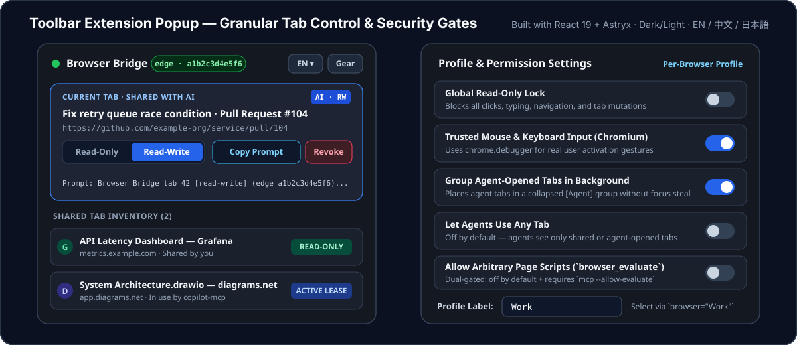

<div align="center">


<br />

[](https://github.com/dcluomax/browser-bridge/actions/workflows/ci.yml)
[](https://github.com/dcluomax/browser-bridge/releases/latest)
[](#四大核心基因本地--安全--fast--自我进化)
[](docs/SECURITY_MODEL.md)
[](#四大核心基因本地--安全--fast--自我进化)
[](#website-optimizations24-个站点优化与剔除网络耗时实测对比)
[](LICENSE)

**[English](README.md)** · **简体中文** · **[站点优化实测](#website-optimizations24-个站点优化与剔除网络耗时实测对比)** · **[1-Prompt 安装手册](docs/INSTALL.md)** · **[升级说明 (v0.11.1)](docs/UPGRADE.md)** · **[版本更新规范](docs/VERSIONING.md)** · **[完整使用指南](docs/USAGE.md)** · **[核心特性详解](docs/FEATURES.md)** · **[Python SDK](python/README.md)** · **[GitHub Wiki](https://github.com/dcluomax/browser-bridge/wiki)**

</div>

---

**Browser Bridge** 是一款专为 AI Agent 与开发者打造的 **纯本地（Local）、零端口安全（Secure）、原生极速（FAST）、自我进化（Self-Evolving）** 浏览器桥接引擎。它让 GitHub Copilot、Claude Desktop / Claude Code、Cursor、Windsurf、Cline 等 MCP 客户端及 Python 脚本，直接安全地运行在你**自己已打开并登录的 Edge、Chrome、Brave 或 Firefox 标签页**中。

---

## 四大核心基因：本地 · 安全 · FAST · 自我进化

| 核心维度 | 底层架构保障 | 实际体验收益 |
| --- | --- | --- |
| **1. 纯本地 (100% LOCAL)** | 100% 运行于本机日常浏览器内，零云端中转、零远程容器、无需下载几百 MB 无头浏览器内核 | 直接复用已登录的企业 SSO、双重验证态、Cookie 与扩展插件，告别重复扫码登录 |
| **2. 零端口安全 (SECURE)** | **0 开放 TCP / WebSocket 端口**；采用系统内核鉴权的 Windows SID 命名管道（`CurrentUserOnly`）与 `0700`/`0600` Unix 套接字 + **三层只读/读写权限锁** + 密码/Token 自动脱敏 | 外部网页与本机其他账户完全无法探测；仅你主动分享的标签页可见，其余私人页面彻底隐身 |
| **3. 原生极速 (FAST)** | **~1.5 MB 零依赖单文件 Rust 宿主**（运行内存仅 ~8 MB），**`~1.1 ms` 管道直连中位延迟**，单次往返按需 DOM 引擎 + 后台无感全页截图 + 零依赖 Python SDK | 亚毫秒级本机通信，无中间子进程开销、不抢占前台窗口焦点 |
| **4. 自我进化 (SELF-EVOLVING)** | **零配置底层引擎消障** + **质量约束型 `SiteLearner` v2**（`waitForDomQuiet` 事件驱动就绪判定、正文完整度底线）+ **24 个带时间戳 `routines/*.json` 站点剧本**（`schemaVersion: 2`、`PATCH` `N=20` 实测门禁、语义重定位与 `[STALE]` 漂移检测）+ **`browser_demonstrate`** + W3C **WebMCP** | 消除多秒级浏览器后处理挂起（在典型第三方 iframe/SSE 阻塞基线上最高提速 **15×–1,800×**），同时强制校验 **`>= 80–85%` 正文完整度**，杜绝把未水合空壳误判为“提速” |

---

## Website Optimizations（24 个站点优化与剔除网络耗时实测对比）

<p align="center">
  
</p>

传统浏览器自动化在真实大站上动辄卡顿 **8–30 秒**，绝大多数延迟**并非花在网络带宽下载 HTML**，而是死锁在浏览器后处理环节：长连接 SSE 流阻塞 Chromium MV3 `document_idle` 脚本注入（`perplexity.ai`）、第三方 Google One-Tap / 广告 iframe 挂起全帧扫描（`medium.com`、`amazon.com`）、统计信标拖住 `window.onload`（`google.com`、`pypi.org`）、多跳 `3xx`/前端重定向假死（`linkedin.com`、`mail.google.com`）、`<canvas>` 画布零 DOM 文本（`Google Docs`、`Google Sheets`）以及 200+ 导航链接挤爆正文快照（`github.com`）。

Browser Bridge 通过**三层职责清晰、可独立复现验证的优化架构**系统性消除上述非网络瓶颈：

1. **第一层：零配置引擎级消障（Zero-Config Engine Mitigations）** —— 包含 `injectImmediately: true` 即时注入、跨 `requestId` 多跳 `watchNavigation` 重定向追踪、`1,500 ms` 子帧采集超时上限、Kix `<canvas>` 与 `#t-name-box` 原生解析，以及 `<main>` 正文智能预算折叠，无需任何站点配置即可提供基础提速。
2. **第二层：事件驱动 DOM 就绪判定与质量约束型 `SiteLearner` v2** —— 用页面内 `MutationObserver` 静默窗口与地标检测谓词（`waitForDomQuiet`）取代盲目 `sleep()` 固定等待（将 `hydrationSettleMs` 严格作为最大超时上限而非固定休眠），遵循全序等待格（`commit < domcontentloaded < load`）、`k >= 3` 样本防抖阈值、连续成功访问自动衰减、路由级 **`>= 85%` 参考正文完整度底线**（确保“极速读取”绝不返回未水合空壳页面），并通过 `_noLearn: true` 严格隔离基准评测流量。
3. **第三层：带时间戳的 `routines/*.json` 站点剧本（内置 24 站）** —— [`routines/*.json`](routines/)（`schemaVersion: 2`）提供单次调用结构化直达路径，支持语义重定位自愈、顶层快照优雅回退、字段级来源合并（`seed` / `learned` / `user`）以及 `[STALE]` 改版漂移告警。

### 剔除网络传输耗时的评测方法（`Excl. Network` 与 `0-Net`）

为彻底剥离不同 Wi-Fi / 运营商网络波动的影响，Browser Bridge 在内容引擎内置了 W3C `PerformanceNavigationTiming.responseEnd` 硬件计时（`page.info(document=True)` 返回 `navigationTiming.networkMs`）并配套提供一键复现实验脚本 [`scripts/benchmark-sites.py`](scripts/benchmark-sites.py)：

1. **剔除网络后的引擎等待开销（`Excl. Network` = `goto + snapshot 总耗时 − HTML 网络下载耗时`）**：仅统计 HTML 字节到达浏览器之后的脚本注入、水合等待与快照提取纯引擎开销。
2. **零网络热标签页直读/交互（`0-Net` = 已打开标签页，网络请求严格为 `0 ms`）**：直接测量 `~1.1 ms` Rust 本机管道 + DOM/Canvas 解析提取耗时。

### 优化前 vs. Browser Bridge `v0.10.1` 实测对比（已剔除网络耗时）

| 网站与时间戳 JSON | 解决的非网络核心瓶颈 | 未优化引擎开销 *(剔除网络)* | `v0.10.1` 引擎开销 *(剔除网络)* | 热页 `0-Net` 快照 / 例程耗时 | 剔除网络实测提速 |
| --- | --- | --- | --- | --- | --- |
| **Perplexity**<br>[`perplexity.ai.json`](routines/perplexity.ai.json) | 活跃 SSE 流阻塞 MV3 `document_idle` 注入 | `18,945–29,000 ms` | **`~450–840 ms`**（`commit` + `injectImmediately`） | **`4–7.8 ms`** 快照 | **`0-Net` 快 >2,400×** · **后处理快 ~35×** |
| **Medium**<br>[`medium.com.json`](routines/medium.com.json) | Google One-Tap GSI 脚本与跨域 iframe 挂起 | `23,163 ms`（热快照挂起 `12,825 ms`） | **`586 ms`** | **`5.7–7 ms`** 快照 | **`0-Net` 快 >1,800×** · **后处理快 39×** |
| **Google Sheets / Excel**<br>[`docs.google.com__spreadsheets.json`](routines/docs.google.com__spreadsheets.json) | `<canvas>` 网格不可读 + 多轮坐标盲点绕路 | `8,077 ms`（`0-Net` 交互绕路）/ 网格空白 | **`~200 ms`** | **`180–259 ms`** `#t-name-box` 读写 · **`~201–325 ms`** CSV | **`0-Net` 单元格读写快 31×–45×** |
| **Google 搜索**<br>[`google.com.json`](routines/google.com.json) | 统计信标阻塞 `onload` + 广告子 iframe 扫描 | `~14,978 ms` | **`532 ms`**（`domcontentloaded` + `top` 单帧） | **`36 ms`** 快照 · **`41 ms`** `read_results` | **后处理快 28×** |
| **Google Docs**<br>[`docs.google.com__document.json`](routines/docs.google.com__document.json) | Kix `<canvas>` 零 DOM 正文 + 字体同步拖尾 | `~6,690 ms` + **Canvas 读出 `0` 字** | **`~350 ms`** | **`10 ms`** `0-Net` `DOCS_modelChunk` 直读 · **`~170 ms`** 全文 | **`10 ms` 零网络攻克 Canvas** |
| **arXiv**<br>[`arxiv.org.json`](routines/arxiv.org.json) | MathJax 字体 `onload` 阻塞 + PDF 阅读繁琐 | `~10,100 ms` | **`~550 ms`** + `{{url.arxivId}}` 一键切 HTML 论文 | **`8.4 ms`** 快照 · **`12 ms`** `read_abstract` | **后处理快 18×** |
| **PyPI**<br>[`pypi.org.json`](routines/pypi.org.json) | 外部徽章/广告脚本阻塞（已剥离 `1,777 ms` 网络下载） | `~7,320 ms` | **`491 ms`**（`commit` + 水合微等待） | **`15.4 ms`** 快照 · **`40–50 ms`** `read_package_docs` | **后处理快 14.9×** |
| **LinkedIn & Gmail**<br>[`linkedin.com.json`](routines/linkedin.com.json) · [`mail.google.com.json`](routines/mail.google.com.json) | 多跳 `3xx`/客户端重定向 `ERR_ABORTED` + `/bind` 长轮询 | `>8,500 ms` 假死等待 | **`~450–950 ms`**（跨 `requestId` 重定向追踪） | **`6–29 ms`** 快照 + 安全草稿 `draft_compose` | **后处理快 ~10×–18×** |
| **Yahoo Finance & Amazon**<br>[`finance.yahoo.com.json`](routines/finance.yahoo.com.json) · [`amazon.com.json`](routines/amazon.com.json) | 20+ 广告追踪 iframe + 软门禁拦截页 | `~7,500–14,500 ms` | **`~350–950 ms`**（`top` 单帧 + 自动过门禁） | **`51 ms`** `read_quote_summary` | **提速 11.5×–140×** |
| **GitHub、Hugging Face、npm & Notion**<br>[`github.com.json`](routines/github.com.json) · [`huggingface.co.json`](routines/huggingface.co.json) · [`npmjs.com.json`](routines/npmjs.com.json) · [`notion.so.json`](routines/notion.so.json) | 200+ 头部/文件树链接挤爆快照导致 `<main>` 被截断 | `1,900–2,800 ms` + 正文截断 | **`~120–350 ms`**（外围导航智能折叠） | **`13 ms`** npm · **`18 ms`** HF · **`50 ms`** GitHub/Notion | **13–50 ms `0-Net` 零截断直读** |
| **ChatGPT & Claude**<br>[`chatgpt.com.json`](routines/chatgpt.com.json) · [`claude.ai.json`](routines/claude.ai.json) | `contentinfo`/ProseMirror 输入框被裁 + 盲目 `sleep` 轮询 | 输入框丢失 + `5–15 s` 固定轮询 | **`~200–350 ms`** 首屏就绪 | **`35–37 ms`** 读对话 · **`117 ms`** 安全填草稿 · Stop 按钮确定等待 | **零盲目轮询等待** |
| **Reddit、X、draw.io、Wikipedia、HN、SO & YouTube**<br>其余 7 个 [`routines/*.json`](routines/) | `shreddit-*` 虚拟滚动、`#fragment` `30 s` 超时、`border=0` 布局表、`#cite_note` 膨胀、Cookie 墙、Polymer 流阻塞 | `8,000–30,000 ms` 超时或截断 | **`~250–650 ms`** | **`5 ms`** X · **`32 ms`** HN（30/30 帖）· **`52 ms`** Wiki（3.5 万字）· **`99 ms`** Reddit JSON · **`660 ms`** draw.io XML | **零超时 · 零截断** |

> **评测方法与统计严谨性说明（Methodology & Statistical Rigor Note）**：真实生产网站在不同会话、地理位置与缓存态下存在显著波动（例如 Medium 的 Google One-Tap 跨域登录挂件或门户广告子帧，在热会话下可能亚秒级返回，而在冷启动或受限网络下可阻塞 `load + allFrames` 达 `12–23s+`）。上表展示受阻塞会话下的峰值卡顿消除效果；进行严格回归评估时，请启用**多轮交错抽样与冻结档案隔离（`--trials N --interleave`，底层自动启用 `_noLearn: true`）**，同时考核**剔除网络后的 `p50 / p95` 分位延迟**与 **`>= 80%` 正文完整度护栏**（防止将未水合空壳页计为无效提速）：
>
> ```bash
> PYTHONPATH=python python scripts/benchmark-sites.py --compare-unoptimized --trials 5 --interleave
> ```

### 时间戳自动升级、`[STALE]` 改版检测与第 3 位版本号（`PATCH 0.10.Z`）实测门禁规范

- **第 3 位小版本号（`PATCH`，`0.10.Z`）实测发版门禁（[`docs/VERSIONING.md`](docs/VERSIONING.md)）**：新增或调优网站 JSON（`routines/*.json`）与改版选择器时，统一递增**第 3 位版本号**（如 `0.10.0` → `0.10.1`）、刷新 UTC `verifiedAt` / `updatedAt` 时间戳，并必须通过 `scripts/check-routine-gate.py` 门禁校验（`schemaVersion: 2` 规范审计 + `N >= 20` 轮交错冻结 `_noLearn: true` 实测，确认 `p50`/`p95` 不回退且相对 `load` 基线满足 `>= 80%` 正文完整度；新增引擎/MCP/SDK 能力递增 `MINOR`，破坏性协议变更递增 `MAJOR`）。
- **字段级来源无损合并（`seed` / `learned` / `user`）**：版本升级时按字段级来源标签合并配置：当 `seed.verifiedAt >= disk.updatedAt` 时自动刷新内置 `seed` 例程与已回退/过期的 `learned` 延迟参数，同时**严格保留 `user` 用户手工覆盖参数、自定义例程与站点笔记**（详见 **[升级说明 `docs/UPGRADE.md`](docs/UPGRADE.md)**）。
- **语义重定位自愈与改版漂移告警（`[STALE]`）**：网页改版导致选择器失效时，先尝试基于 ARIA 角色与地标的语义重定位，失败则立即优雅回退至安全的顶层快照路径；连续 `>= 2` 次失配自动标记 `[STALE]` 与 `staleReason`，引导 Agent 重新快照并通过 `browser_routine_save` 热更新。
- **Routine Engine v2 模板与别名**：支持同域路径隔离（`docs.google.com/document` vs `docs.google.com/spreadsheets`）、友好别名（`google-docs`、`google-sheets`、`google-excel`、`gmail`、`chatgpt`、`claude`、`perplexity`、`notion`、`hf`、`npm`、`pypi`、`arxiv`、`linkedin`、`medium`）、同源 `op: "fetch"`（`stripHtml`）、`{{param:urlencode}}` 及自动 URL 变量（`{{url.docId}}`、`{{url.gid}}`、`{{url.repo}}`、`{{url.arxivId}}`、`{{url.cleanPath}}`、`{{url.origin}}`）。

---

## 一句 Prompt 开箱即用（快速上手）

<p align="center">
  
</p>

### 第一步：安装宿主并注册 MCP

#### 方式一（强烈推荐）：一句 Prompt 让 AI 全自动安装（无需 Rust / Node 编译环境）

直接把下面这一句提示词发给 **GitHub Copilot（VS Code / CLI）**、**Claude Code**、**Cursor**、**Windsurf**、**Cline** 或 **Codex**：

```text
请按 https://raw.githubusercontent.com/dcluomax/browser-bridge/main/docs/INSTALL.md 为我安装并配置好 Browser Bridge：自动下载当前系统预编译包并校验 SHA-256，注册 Native Host 与我当前的 AI 客户端 MCP 配置，运行 BrowserBridge status 验证，并告诉我浏览器加载扩展的具体目录路径。
```

> 如需强制只读安全模式或同时安装 Python SDK，只需在提示词末尾加上 *“开启只读 MCP 模式”* 或 *“同时安装 Python SDK”* 即可。

<details>
<summary><strong>方式二：终端一行命令免编译安装（自动校验 SHA-256 与配置 MCP）</strong></summary>

**Windows (PowerShell)：**

```powershell
irm https://raw.githubusercontent.com/dcluomax/browser-bridge/main/scripts/bootstrap.ps1 | iex
```

**macOS / Linux：**

```bash
curl -fsSL https://raw.githubusercontent.com/dcluomax/browser-bridge/main/scripts/bootstrap.sh | bash
```

</details>

<details>
<summary><strong>方式三：从源码一行命令编译安装（需 Rust 1.85+ 与 Node.js 20+）</strong></summary>

**Windows (PowerShell)：**

```powershell
git clone https://github.com/dcluomax/browser-bridge.git
cd browser-bridge
.\scripts\install.ps1 -RegisterAllMcp -InstallPythonSdk
```

**macOS / Linux：**

```bash
git clone https://github.com/dcluomax/browser-bridge.git
cd browser-bridge
./scripts/install.sh --register-all --install-python
```

> 只需注册单个客户端时，可传入 `-RegisterCopilotMcp`、`-RegisterClaudeMcp` 或 `-RegisterCursorMcp`（macOS/Linux 对应 `--register-copilot`、`--register-claude`、`--register-cursor`）。附加 `-ReadOnlyMcp` / `--read-only` 可开启主机级强制只读模式。

</details>

### 第二步：在浏览器加载扩展（每个浏览器配置仅需一次）

安装脚本会将构建产物复制到稳定的用户级目录，后续更新代码或重新编译不会影响正在运行的浏览器：

| 浏览器 | 加载路径 | 选择目录 / 文件 |
| --- | --- | --- |
| **Microsoft Edge** | 打开 `edge://extensions` → 开启**开发人员模式** → **加载解压缩的扩展** | Windows: `%LOCALAPPDATA%\BrowserBridge\extension\chromium`<br>macOS/Linux: `~/.browser-bridge/extension/chromium` |
| **Chrome / Brave** | 打开 `chrome://extensions` → 开启**开发者模式** → **加载已解压的扩展程序** | Windows: `%LOCALAPPDATA%\BrowserBridge\extension\chromium`<br>macOS/Linux: `~/.browser-bridge/extension/chromium` |
| **Mozilla Firefox** | 打开 `about:debugging#/runtime/this-firefox` → **临时载入附加组件** | Windows: `%LOCALAPPDATA%\BrowserBridge\extension\firefox\manifest.json`<br>macOS/Linux: `~/.browser-bridge/extension/firefox/manifest.json` |

运行状态自检命令确认连接：

```bash
# Windows
"%LOCALAPPDATA%\BrowserBridge\app\BrowserBridge.exe" status

# macOS / Linux
~/.browser-bridge/app/BrowserBridge status
```

连接成功后，浏览器工具栏中的 Browser Bridge 图标会亮起**绿色圆点**。

### 第三步：一键分享标签页并交给 AI

1. 在目标网页点击工具栏 **Browser Bridge** 图标（或在网页空白处**右键 → Browser Bridge**）。
2. 选择 **`只读分享 (Read-Only)`**（仅允许读取快照与后台截图）或 **`读写分享 (Read-Write)`**（允许点击、填表与交互）。
3. 点击 **复制提示词 (Copy Prompt)** 粘贴给任意 AI 助手，或直接在对话中让 MCP Agent 读取当前已分享的标签页。

---

## 零端口本地架构与安全边界

<p align="center">
  
</p>

- **零网络暴露**：仅通过当前系统用户专属的 Windows Named Pipe（`CurrentUserOnly` DACL）或 `0700`/`0600` Unix Domain Socket 通信，网页脚本与局域网无法探测或连接。
- **三层读写权限锁 + 域名围栏 (`allowedOrigins`)**：支持 MCP 启动级 `--read-only`、扩展弹窗全局只读总开关、单标签页 `Read-Only` / `Read-Write` 细粒度授权，以及 `browser_allowlist` 域名白名单围栏。
- **后台静默折叠标签组与空闲自动回收**：Agent 新开标签页默认静默在后台打开（`active: false`）并收纳进折叠的 Chromium `[Agent]` 标签组，支持具名持久标签（`name="work-doc"`）、10 分钟空闲自动回收及 `RW/RO/RUN/WAIT` 动态徽标。
- **会话独占租约与自动脱敏诊断**：同一时刻每个标签页最多由一个 Agent 会话控制；`browser_network` 抓包与 `browser_console` 控制台自动将密码框、`Authorization`、Bearer Token、JWT 与 Cookie 请求头脱敏为 `[REDACTED]`。
- **页内人机交接卡片与无密码录制 (`browser_handoff` / `browser_demonstrate`)**：遇到登录、2FA/MFA、Cloudflare/CAPTCHA 或支付时，通过封闭 ShadowRoot 弹出 `WAIT` 继续卡片交还人工处理；支持人工演示操作一键录制为可复用 Routine（自动忽略所有密码与 OTP 输入）。

---

## 扩展弹窗界面、长尾自学习 `SiteLearner` 与原生 WebMCP

<p align="center">
  
</p>

- **质量约束型长尾自学习 (`SiteLearner` v2)**：即使访问 24 个内置 [`routines/*.json`](routines/) 之外的内部系统或长尾网站，也会在全序等待策略（`commit < domcontentloaded < load`）与事件驱动 `waitForDomQuiet` 静默窗口上限之间执行质量约束多臂赌博机选择：满足 `k >= 3` 次一致观测才切换策略、强制执行 `>= 85%` 正文完整度底线与安全回退、连续稳定访问自动衰减等待上限、遵守 `_noLearn` 探测隔离，并自动记录遮挡弹窗恢复三元组与 `403` WAF 标签页路由。
- **原生 W3C WebMCP 支持**：跨浏览器自动发现并调用网页通过 `document.modelContext` 注册的工具与声明式 `<form toolname="...">` 表单工具。
- **零依赖 Python SDK (`v0.11.1`)**：直接连接本地管道（中位延迟 `~1.1 ms`），支持 `page.batch([...])` 单次往返多步批处理、后台具名标签页、`allowlist`、`handoff`、脱敏网络/控制台捕获，以及 `**kwargs` / `{{url.arxivId}}` / `{{url.cleanPath}}` 例程执行。

---

## 文档导航

- **[1-Prompt 零编译安装手册 (docs/INSTALL.md)](docs/INSTALL.md)**
- **[v0.10.x / v0.11.0 → v0.11.1 升级说明 (docs/UPGRADE.md)](docs/UPGRADE.md)** · **[版本更新规范 (docs/VERSIONING.md)](docs/VERSIONING.md)** · **[更新日志 (CHANGELOG.md)](CHANGELOG.md)**
- **[完整使用手册 (docs/USAGE.md)](docs/USAGE.md)**
- **[核心特性与 31+1 个 MCP 工具详解 (docs/FEATURES.md)](docs/FEATURES.md)**
- **[MCP 客户端一键配置大全 (docs/MCP_CLIENTS.md)](docs/MCP_CLIENTS.md)**
- **[安全与隐私白皮书 (docs/SECURITY_MODEL.md)](docs/SECURITY_MODEL.md)**
- **[跨语言 IPC 协议规范 (docs/IPC_PROTOCOL.md)](docs/IPC_PROTOCOL.md)**
- **[Python SDK 指南 (python/README.md)](python/README.md)**
- **[贡献指南 (CONTRIBUTING.md)](CONTRIBUTING.md)** · **[安全策略 (SECURITY.md)](SECURITY.md)**

---

## 开源许可

本项目基于 **[MIT License](LICENSE)** 开源 · Copyright © [dcluomax](https://github.com/dcluomax)。
