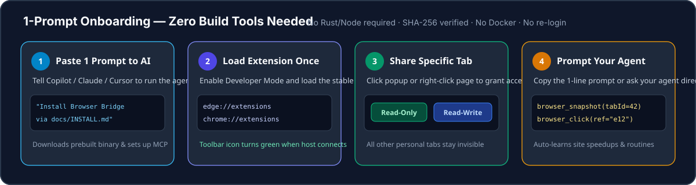
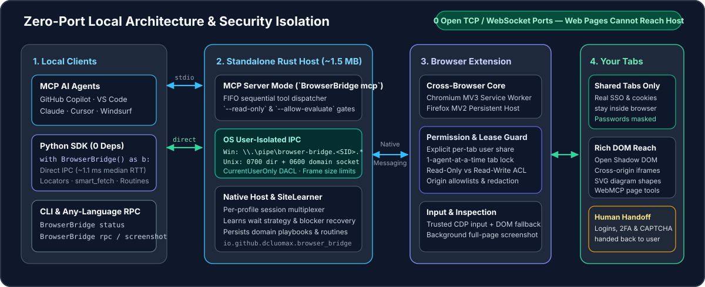
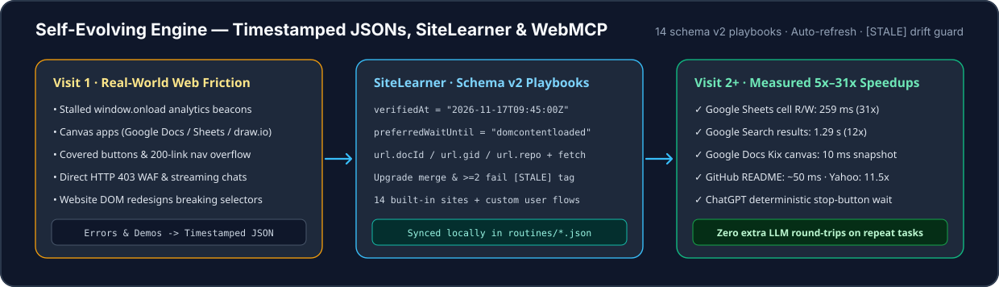

<div align="center">


<br />

[](https://github.com/dcluomax/browser-bridge/actions/workflows/ci.yml)
[](#四大核心基因本地--安全--fast--自我进化)
[](docs/SECURITY_MODEL.md)
[](#四大核心基因本地--安全--fast--自我进化)
[](docs/FEATURES.md)
[](LICENSE)

**[English](README.md)** · **简体中文** · **[1-Prompt 安装手册](docs/INSTALL.md)** · **[完整使用指南](docs/USAGE.md)** · **[核心特性详解](docs/FEATURES.md)** · **[MCP 客户端配置](docs/MCP_CLIENTS.md)** · **[Python SDK](python/README.md)** · **[GitHub Wiki](https://github.com/dcluomax/browser-bridge/wiki)**

</div>

---

**Browser Bridge** 是一款专为 AI Agent 与开发者打造的 **纯本地（Local）、零端口安全（Secure）、原生极速（FAST）、自我进化（Self-Evolving）** 浏览器桥接引擎。它让 GitHub Copilot、Claude Desktop / Claude Code、Cursor、Windsurf、Cline 等 MCP 客户端及 Python 脚本，直接安全地运行在你**自己已打开并登录的 Edge、Chrome、Brave 或 Firefox 标签页**中。

---

## 四大核心基因：本地 · 安全 · FAST · 自我进化

| 核心维度 | 底层架构保障 | 实际体验收益 |
| --- | --- | --- |
| **1. 纯本地 (100% LOCAL)** | 100% 运行于本机日常浏览器内，零云端中转、零远程容器、无需下载几百 MB 无头浏览器内核 | 直接复用已登录的企业 SSO、双重验证态、Cookie 与扩展插件，告别重复扫码登录 |
| **2. 零端口安全 (SECURE)** | **0 开放 TCP / WebSocket 端口**；采用系统内核鉴权的 Windows SID 命名管道（`CurrentUserOnly`）与 `0700`/`0600` Unix 套接字 + **三层只读/读写权限锁** + 密码/Token 自动脱敏 | 外部网页与本机其他账户完全无法探测；仅你主动分享的标签页可见，其余私人页面彻底隐身 |
| **3. 原生极速 (FAST)** | **~1.5 MB 零依赖单文件 Rust 宿主**（运行内存仅 ~8 MB），**`~1.1 ms` 管道直连中位延迟**，单次往返按需 DOM 引擎 + 后台无感全页截图 + 零依赖 Python SDK | 亚毫秒级本机通信，无中间子进程开销、不抢占前台窗口焦点 |
| **4. 自我进化 (SELF-EVOLVING)** | 错误驱动学习引擎 **`SiteLearner`** + 本机站点记忆例程（**Site Memory Routines**）+ 原生 W3C **WebMCP (`document.modelContext`)** | 首次访问遇到 `onload` 阻塞、SPA 水合重绘、遮罩弹窗阻挡或 `403` WAF 拦截后自动学会最优策略并沉淀为一句话例程，越用越快 |

---

## 一句 Prompt 开箱即用（快速上手）

<p align="center">
  
</p>

### 第一步：安装宿主并注册 MCP

#### 方式一（强烈推荐）：一句 Prompt 让 AI 全自动安装（无需 Rust / Node 编译环境）

直接把下面这一句提示词发给 **GitHub Copilot（VS Code / CLI）**、**Claude Code**、**Cursor**、**Windsurf**、**Cline** 或 **Codex**：

```text
请按 https://raw.githubusercontent.com/dcluomax/browser-bridge/main/docs/INSTALL.md 为我安装并配置好 Browser Bridge：自动下载当前系统预编译包并校验 SHA-256，注册 Native Host 与我当前的 AI 客户端 MCP 配置，运行 BrowserBridge status 验证，并告诉我浏览器加载扩展的具体目录路径。
```

> 如需强制只读安全模式或同时安装 Python SDK，只需在提示词末尾加上 *“开启只读 MCP 模式”* 或 *“同时安装 Python SDK”* 即可。

<details>
<summary><strong>方式二：终端一行命令免编译安装（自动校验 SHA-256 与配置 MCP）</strong></summary>

**Windows (PowerShell)：**

```powershell
irm https://raw.githubusercontent.com/dcluomax/browser-bridge/main/scripts/bootstrap.ps1 | iex
```

**macOS / Linux：**

```bash
curl -fsSL https://raw.githubusercontent.com/dcluomax/browser-bridge/main/scripts/bootstrap.sh | bash
```

</details>

<details>
<summary><strong>方式三：从源码一行命令编译安装（需 Rust 1.85+ 与 Node.js 20+）</strong></summary>

**Windows (PowerShell)：**

```powershell
git clone https://github.com/dcluomax/browser-bridge.git
cd browser-bridge
.\scripts\install.ps1 -RegisterAllMcp -InstallPythonSdk
```

**macOS / Linux：**

```bash
git clone https://github.com/dcluomax/browser-bridge.git
cd browser-bridge
./scripts/install.sh --register-all --install-python
```

> 只需注册单个客户端时，可传入 `-RegisterCopilotMcp`、`-RegisterClaudeMcp` 或 `-RegisterCursorMcp`（macOS/Linux 对应 `--register-copilot`、`--register-claude`、`--register-cursor`）。附加 `-ReadOnlyMcp` / `--read-only` 可开启主机级强制只读模式。

</details>

### 第二步：在浏览器加载扩展（每个浏览器配置仅需一次）

安装脚本会将构建产物复制到稳定的用户级目录，后续更新代码或重新编译不会影响正在运行的浏览器：

| 浏览器 | 加载路径 | 选择目录 / 文件 |
| --- | --- | --- |
| **Microsoft Edge** | 打开 `edge://extensions` → 开启**开发人员模式** → **加载解压缩的扩展** | Windows: `%LOCALAPPDATA%\BrowserBridge\extension\chromium`<br>macOS/Linux: `~/.browser-bridge/extension/chromium` |
| **Chrome / Brave** | 打开 `chrome://extensions` → 开启**开发者模式** → **加载已解压的扩展程序** | Windows: `%LOCALAPPDATA%\BrowserBridge\extension\chromium`<br>macOS/Linux: `~/.browser-bridge/extension/chromium` |
| **Mozilla Firefox** | 打开 `about:debugging#/runtime/this-firefox` → **临时载入附加组件** | Windows: `%LOCALAPPDATA%\BrowserBridge\extension\firefox\manifest.json`<br>macOS/Linux: `~/.browser-bridge/extension/firefox/manifest.json` |

运行状态自检命令确认连接：

```bash
# Windows
"%LOCALAPPDATA%\BrowserBridge\app\BrowserBridge.exe" status

# macOS / Linux
~/.browser-bridge/app/BrowserBridge status
```

连接成功后，浏览器工具栏中的 Browser Bridge 图标会亮起**绿色圆点**。

### 第三步：一键分享标签页并交给 AI

1. 在目标网页点击工具栏 **Browser Bridge** 图标（或在网页空白处**右键 → Browser Bridge**）。
2. 选择 **`只读分享 (Read-Only)`**（仅允许读取快照与后台截图）或 **`读写分享 (Read-Write)`**（允许点击、填表与交互）。
3. 点击 **复制提示词 (Copy Prompt)** 粘贴给任意 AI 助手，或直接在对话中让 MCP Agent 读取当前已分享的标签页。

---

## 零端口本地架构与安全边界

<p align="center">
  
</p>

- **零网络暴露**：仅通过当前系统用户专属的 Windows Named Pipe（`CurrentUserOnly` DACL）或 `0700`/`0600` Unix Domain Socket 通信，网页脚本与局域网无法探测或连接。
- **三层读写权限锁**：支持 MCP 启动级 `--read-only`、扩展弹窗全局只读总开关、以及单标签页 `Read-Only` / `Read-Write` 细粒度授权。
- **会话独占租约**：同一时刻每个标签页最多由一个 Agent 会话控制，断开即自动释放；密码框值、Bearer Token、JWT 与 Cookie 请求头自动脱敏为 `[REDACTED]`。
- **人机协同交接**：遇到登录、MFA 双重验证或 CAPTCHA 时不绕过、不伪造指纹，直接交还用户在原标签页完成验证。

---

## 扩展弹窗界面与自适应站点记忆

<p align="center">
  
</p>

<p align="center">
  
</p>

- **错误驱动站点学习 (`SiteLearner`)**：首次访问遇到长连接统计脚本阻塞 `onload`、SPA 水合重渲染、遮罩弹窗阻挡点击或 `403` WAF 拦截时，自动学习最优等待策略（`domcontentloaded`）、水合等待时间、弹窗恢复动作三元组及浏览器会话 `smart_fetch`，二次访问毫秒级直达。
- **可执行站点例程 (`Site Memory Routines`)**：内置 `app.diagrams.net` 图表读写例程，支持通过 `browser_routine_save` 沉淀任意网站的高频多步工作流，一次调用完成复杂交互。
- **原生 W3C WebMCP 支持**：跨浏览器自动发现并调用网页通过 `document.modelContext` 注册的工具与声明式 `<form toolname="...">` 表单工具。
- **零依赖 Python SDK**：直接连接本地管道（中位延迟 `~1.1 ms`），提供类 Playwright 链式定位器、后台无焦点全页截图与双上下文 HTTP 请求。

---

## 文档导航

- **[完整使用手册 (docs/USAGE.md)](docs/USAGE.md)**
- **[功能与 26 个 MCP 工具详解 (docs/FEATURES.md)](docs/FEATURES.md)**
- **[MCP 客户端一键配置大全 (docs/MCP_CLIENTS.md)](docs/MCP_CLIENTS.md)**
- **[安全与隐私白皮书 (docs/SECURITY_MODEL.md)](docs/SECURITY_MODEL.md)**
- **[跨语言 IPC 协议规范 (docs/IPC_PROTOCOL.md)](docs/IPC_PROTOCOL.md)**
- **[Python SDK 指南 (python/README.md)](python/README.md)**
- **[贡献指南 (CONTRIBUTING.md)](CONTRIBUTING.md)** · **[安全策略 (SECURITY.md)](SECURITY.md)**

---

## 开源许可

本项目基于 **[MIT License](LICENSE)** 开源 · Copyright © [dcluomax](https://github.com/dcluomax)。
