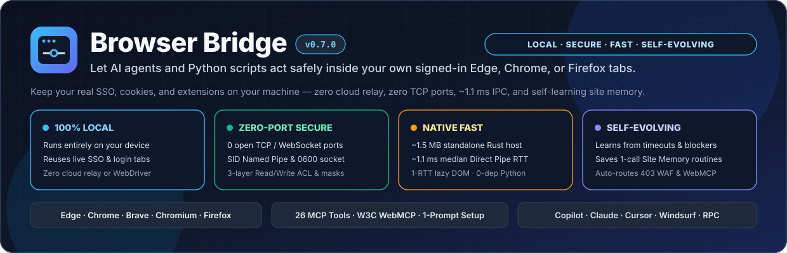

<div align="center">



<br />

[](https://github.com/dcluomax/browser-bridge/actions/workflows/ci.yml)
[](https://github.com/dcluomax/browser-bridge/releases/latest)
[](#四大核心基因本地--安全--fast--自我进化)
[](docs/SECURITY_MODEL.md)
[](#四大核心基因本地--安全--fast--自我进化)
[](#带时间戳的站点优化-json-与实测提速效果-v0100)
[](LICENSE)

**[English](README.md)** · **简体中文** · **[1-Prompt 安装手册](docs/INSTALL.md)** · **[升级说明 (v0.10.0)](docs/UPGRADE.md)** · **[完整使用指南](docs/USAGE.md)** · **[核心特性详解](docs/FEATURES.md)** · **[MCP 客户端配置](docs/MCP_CLIENTS.md)** · **[Python SDK](python/README.md)** · **[GitHub Wiki](https://github.com/dcluomax/browser-bridge/wiki)**

</div>

---

**Browser Bridge** 是一款专为 AI Agent 与开发者打造的 **纯本地（Local）、零端口安全（Secure）、原生极速（FAST）、自我进化（Self-Evolving）** 浏览器桥接引擎。它让 GitHub Copilot、Claude Desktop / Claude Code、Cursor、Windsurf、Cline 等 MCP 客户端及 Python 脚本，直接安全地运行在你**自己已打开并登录的 Edge、Chrome、Brave 或 Firefox 标签页**中。

---

## 四大核心基因：本地 · 安全 · FAST · 自我进化

| 核心维度 | 底层架构保障 | 实际体验收益 |
| --- | --- | --- |
| **1. 纯本地 (100% LOCAL)** | 100% 运行于本机日常浏览器内，零云端中转、零远程容器、无需下载几百 MB 无头浏览器内核 | 直接复用已登录的企业 SSO、双重验证态、Cookie 与扩展插件，告别重复扫码登录 |
| **2. 零端口安全 (SECURE)** | **0 开放 TCP / WebSocket 端口**；采用系统内核鉴权的 Windows SID 命名管道（`CurrentUserOnly`）与 `0700`/`0600` Unix 套接字 + **三层只读/读写权限锁** + 密码/Token 自动脱敏 | 外部网页与本机其他账户完全无法探测；仅你主动分享的标签页可见，其余私人页面彻底隐身 |
| **3. 原生极速 (FAST)** | **~1.5 MB 零依赖单文件 Rust 宿主**（运行内存仅 ~8 MB），**`~1.1 ms` 管道直连中位延迟**，单次往返按需 DOM 引擎 + 后台无感全页截图 + 零依赖 Python SDK | 亚毫秒级本机通信，无中间子进程开销、不抢占前台窗口焦点 |
| **4. 自我进化 (SELF-EVOLVING)** | **14 个带时间戳 `routines/*.json` 站点剧本**（`schemaVersion: 2`、`verifiedAt` 升级自动合并、`[STALE]` 改版漂移检测）+ **`SiteLearner`** + **`browser_demonstrate` 演示录制** + W3C **WebMCP** | Google 搜索、Google Docs、Google Sheets/Excel、GitHub、ChatGPT、Amazon、Yahoo Finance **实测提速 5×–31×**，高频工作流 1 次调用直达 |

---

## 一句 Prompt 开箱即用（快速上手）

<p align="center">
  
</p>

### 第一步：安装宿主并注册 MCP

#### 方式一（强烈推荐）：一句 Prompt 让 AI 全自动安装（无需 Rust / Node 编译环境）

直接把下面这一句提示词发给 **GitHub Copilot（VS Code / CLI）**、**Claude Code**、**Cursor**、**Windsurf**、**Cline** 或 **Codex**：

```text
请按 https://raw.githubusercontent.com/dcluomax/browser-bridge/main/docs/INSTALL.md 为我安装并配置好 Browser Bridge：自动下载当前系统预编译包并校验 SHA-256，注册 Native Host 与我当前的 AI 客户端 MCP 配置，运行 BrowserBridge status 验证，并告诉我浏览器加载扩展的具体目录路径。
```

> 如需强制只读安全模式或同时安装 Python SDK，只需在提示词末尾加上 *“开启只读 MCP 模式”* 或 *“同时安装 Python SDK”* 即可。

<details>
<summary><strong>方式二：终端一行命令免编译安装（自动校验 SHA-256 与配置 MCP）</strong></summary>

**Windows (PowerShell)：**

```powershell
irm https://raw.githubusercontent.com/dcluomax/browser-bridge/main/scripts/bootstrap.ps1 | iex
```

**macOS / Linux：**

```bash
curl -fsSL https://raw.githubusercontent.com/dcluomax/browser-bridge/main/scripts/bootstrap.sh | bash
```

</details>

<details>
<summary><strong>方式三：从源码一行命令编译安装（需 Rust 1.85+ 与 Node.js 20+）</strong></summary>

**Windows (PowerShell)：**

```powershell
git clone https://github.com/dcluomax/browser-bridge.git
cd browser-bridge
.\scripts\install.ps1 -RegisterAllMcp -InstallPythonSdk
```

**macOS / Linux：**

```bash
git clone https://github.com/dcluomax/browser-bridge.git
cd browser-bridge
./scripts/install.sh --register-all --install-python
```

> 只需注册单个客户端时，可传入 `-RegisterCopilotMcp`、`-RegisterClaudeMcp` 或 `-RegisterCursorMcp`（macOS/Linux 对应 `--register-copilot`、`--register-claude`、`--register-cursor`）。附加 `-ReadOnlyMcp` / `--read-only` 可开启主机级强制只读模式。

</details>

### 第二步：在浏览器加载扩展（每个浏览器配置仅需一次）

安装脚本会将构建产物复制到稳定的用户级目录，后续更新代码或重新编译不会影响正在运行的浏览器：

| 浏览器 | 加载路径 | 选择目录 / 文件 |
| --- | --- | --- |
| **Microsoft Edge** | 打开 `edge://extensions` → 开启**开发人员模式** → **加载解压缩的扩展** | Windows: `%LOCALAPPDATA%\BrowserBridge\extension\chromium`<br>macOS/Linux: `~/.browser-bridge/extension/chromium` |
| **Chrome / Brave** | 打开 `chrome://extensions` → 开启**开发者模式** → **加载已解压的扩展程序** | Windows: `%LOCALAPPDATA%\BrowserBridge\extension\chromium`<br>macOS/Linux: `~/.browser-bridge/extension/chromium` |
| **Mozilla Firefox** | 打开 `about:debugging#/runtime/this-firefox` → **临时载入附加组件** | Windows: `%LOCALAPPDATA%\BrowserBridge\extension\firefox\manifest.json`<br>macOS/Linux: `~/.browser-bridge/extension/firefox/manifest.json` |

运行状态自检命令确认连接：

```bash
# Windows
"%LOCALAPPDATA%\BrowserBridge\app\BrowserBridge.exe" status

# macOS / Linux
~/.browser-bridge/app/BrowserBridge status
```

连接成功后，浏览器工具栏中的 Browser Bridge 图标会亮起**绿色圆点**。

### 第三步：一键分享标签页并交给 AI

1. 在目标网页点击工具栏 **Browser Bridge** 图标（或在网页空白处**右键 → Browser Bridge**）。
2. 选择 **`只读分享 (Read-Only)`**（仅允许读取快照与后台截图）或 **`读写分享 (Read-Write)`**（允许点击、填表与交互）。
3. 点击 **复制提示词 (Copy Prompt)** 粘贴给任意 AI 助手，或直接在对话中让 MCP Agent 读取当前已分享的标签页。

---

## 零端口本地架构与安全边界

<p align="center">
  
</p>

- **零网络暴露**：仅通过当前系统用户专属的 Windows Named Pipe（`CurrentUserOnly` DACL）或 `0700`/`0600` Unix Domain Socket 通信，网页脚本与局域网无法探测或连接。
- **三层读写权限锁 + 域名围栏 (`allowedOrigins`)**：支持 MCP 启动级 `--read-only`、扩展弹窗全局只读总开关、单标签页 `Read-Only` / `Read-Write` 细粒度授权，以及 `browser_allowlist` 域名白名单围栏。
- **后台静默折叠标签组与空闲自动回收**：Agent 新开标签页默认静默在后台打开（`active: false`）并收纳进折叠的 Chromium `[Agent]` 标签组，支持具名持久标签（`name="work-doc"`）、10 分钟空闲自动回收及 `RW/RO/RUN/WAIT` 动态徽标。
- **会话独占租约与自动脱敏诊断**：同一时刻每个标签页最多由一个 Agent 会话控制；`browser_network` 抓包与 `browser_console` 控制台自动将密码框、`Authorization`、Bearer Token、JWT 与 Cookie 请求头脱敏为 `[REDACTED]`。
- **页内人机交接卡片与无密码录制 (`browser_handoff` / `browser_demonstrate`)**：遇到登录、2FA/MFA、Cloudflare/CAPTCHA 或支付时，通过封闭 ShadowRoot 弹出 `WAIT` 继续卡片交还人工处理；支持人工演示操作一键录制为可复用 Routine（自动忽略所有密码与 OTP 输入）。

---

## 带时间戳的站点优化 JSON 与实测提速效果（`v0.10.0`）

<p align="center">
  
</p>

<p align="center">
  
</p>

> **从 `v0.7.0` 升级到 `v0.10.0` 说明**：重新运行一行免编译安装脚本（或 `scripts/install.*`），然后在 `edge://extensions` / `chrome://extensions` 点击一次 **刷新 (`↻`)** 即可完成升级。内置 JSON 的 `verifiedAt` 若新于本地旧缓存的 `updatedAt` 将**自动无损更新内置选择器，同时完整保留你自定义的流程与笔记**。完整步骤见 **[升级说明 (docs/UPGRADE.md)](docs/UPGRADE.md)** 与 **[更新日志 (CHANGELOG.md)](CHANGELOG.md)**。

`v0.10.0` 在顶层 [`routines/`](routines/) 目录内置了 **14 个独立版本化、带时间戳的站点优化 JSON**（`schemaVersion: 2`）：

- **ISO-8601 时间戳与小版本无损自动刷新**：每个 JSON 文件及每条 Routine 均携带 `verifiedAt`、`updatedAt` 与 `speedupSummary`。版本升级时自动对比时间戳，仅刷新过期的内置选择器，绝不覆盖用户自定义例程。
- **网站改版自动漂移告警 (`[STALE]`)**：当目标网站前端改版导致某条 Routine 连续 `>= 2` 次选择器或超时失败时，自动标记 `[STALE]` 与 `staleReason`，引导 Agent 重新 `browser_snapshot` 并通过 `browser_routine_save` 热更新。
- **同域多应用路径隔离、别名与动态 URL 变量**：精确区分 `docs.google.com/document` 与 `docs.google.com/spreadsheets`，支持 `google-docs`、`google-sheets`、`google-excel`、`chatgpt` 等友好别名，原生支持同源会话请求 `op: "fetch"`（含 `stripHtml`）、`{{param:urlencode}}` 以及自动提取 `{{url.docId}}`、`{{url.gid}}`、`{{url.repo}}`、`{{url.origin}}`。

### 5 大核心网站引擎级优化与实测提速对比

| 核心站点与 JSON 文件 | 引擎级 DOM/Canvas 优化 + 内置例程 | 优化前 (`v0.7.0`) | 优化后 (`v0.10.0`) | 实测提速幅度 |
| --- | --- | --- | --- | --- |
| **Google 搜索**<br>[`routines/google.com.json`](routines/google.com.json) | `domcontentloaded` + `top` 单帧快路径 + `search(query)` / `read_results()` / `next_results_page()` | `15,495 ms` | **`1,292–1,423 ms`** | **提速约 11–12×** |
| **Google Docs**<br>[`routines/docs.google.com__document.json`](routines/docs.google.com__document.json) | 快速打开 + 原生解析 Kix `<canvas>` `DOCS_modelChunk` 文本块（**`10 ms`** 快照直出正文，零网络请求、零 `eval`）+ 同源 `/mobilebasic` 跨页无损读取 `read_document` + `append_text` / `replace_text` / `rename_document` | `8,218 ms` 打开 / Canvas 空白 | **`1,528 ms`** 打开 · **`10 ms`** 快照 · **`~170–267 ms`** 全文 | **提速 5.4×** + 攻克 Canvas |
| **Google Sheets / Excel**<br>[`routines/docs.google.com__spreadsheets.json`](routines/docs.google.com__spreadsheets.json) | 自动为 `#t-name-box` 与 `#t-formula-bar-input` 赋予可访问名称 + 同源 `/gviz/tq?tqx=out:csv` 整表导出 `read_sheet_csv` + 坐标精准跳转读写 `read_cell` / `write_cell` / `select_range` | `8,077 ms` / Canvas 网格无法抓取 | **`259 ms`** 单元格读写 · **`~201–325 ms`** 整表 CSV | **提速 31×** |
| **GitHub**<br>[`routines/github.com.json`](routines/github.com.json) | `domcontentloaded` + `120 ms` Turbo 水合 + 200+ 仓库导航链接溢出自动折叠 + 自动 `{{url.repo}}` 变量；`read_main_content`、`search_repo_issues`、`search_github`、`go_to_file` | `3,469 ms` 跳转 + 头部撑爆截断 | **`~920 ms`** 跳转 · **`~50 ms`** 完整提取 README/PR | **提速 3.8×** + 零截断 |
| **ChatGPT**<br>[`routines/chatgpt.com.json`](routines/chatgpt.com.json) | 保护 `contentinfo` 内 `<form>` 输入框免遭外围折叠裁剪 + `draft_prompt` 安全草稿填入 + 监测 `stop-button` 消失确定性等待流式回答完成 (`ask_and_wait`)、`read_conversation`、`new_chat` | 盲目轮询等待 / 输入区被裁 | **`~690–914 ms`** 首屏 · **`117 ms`** 安全填草稿 | 告别盲目轮询 |

### 其余 9 大内置站点时间戳 JSON 实测效果

| 站点 JSON 文件 | 内置快捷例程 | 专项优化与实测数据 |
| --- | --- | --- |
| [`routines/diagrams.net.json`](routines/diagrams.net.json) | `read_diagram_xml`, `write_diagram_xml`, `insert_shape`, `add_page` | PWA `#fragment` 打开免 30s 超时；XML 读取 **`660 ms`**、写入 **`870 ms`**、插图 **`1.64 s`** |
| [`routines/amazon.com.json`](routines/amazon.com.json) | `search_products`, `read_product_details` | 自动过软门禁 + `domcontentloaded` + 跳过广告 iframe：搜索从 `16,043 ms` 降至 **`2,491 ms`（提速 6.4×）** |
| [`routines/finance.yahoo.com.json`](routines/finance.yahoo.com.json) | `lookup_quote`, `read_quote_summary` | `domcontentloaded` + 单帧 + 顶部导航压缩：实时行情查询从 `8,050 ms+` 降至 **`702 ms`（提速 11.5×）** |
| [`routines/youtube.com.json`](routines/youtube.com.json) | `search_videos`, `open_transcript` | `domcontentloaded` + `250 ms` Polymer 水合：**`2,042 ms`** 完成视频搜索（免除 30s 流媒体阻塞） |
| [`routines/wikipedia.org.json`](routines/wikipedia.org.json) | `search_article`, `read_article` | `#cite_note` 页内引用锚点自动压缩（每篇省 ~8 KB 预算）+ **`~2.2 s`** 提取 35k 字完整词条正文 |
| [`routines/news.ycombinator.com.json`](routines/news.ycombinator.com.json) | `read_front_page`, `search_hn` | 自动拍平 `border=0` 嵌套布局表格，30 条首页帖子零截断完整输出 |
| [`routines/stackoverflow.com.json`](routines/stackoverflow.com.json) | `dismiss_cookies`, `search_questions`, `read_qa` | 自动关闭 `#onetrust-banner-sdk` 遮罩 + 保留 1,200 字完整代码块 + **`~60 ms`** 提取问答正文 |
| [`routines/reddit.com.json`](routines/reddit.com.json) | `search_reddit`, `read_thread` | 标记 `directHttpBlocked = true` 免除匿名 `403` 重试 + 穿透 `shreddit-*` Shadow DOM 与未分发子节点 |
| [`routines/x.com.json`](routines/x.com.json) | `search_posts`, `draft_post` | `domcontentloaded` + `350 ms` SPA 水合 + 自动识别 Cloudflare 质询并提示 `browser_handoff` |

- **未知网站错误驱动自学习 (`SiteLearner`)**：即使访问未内置 JSON 的长尾网站，遇到 `onload` 超时、SPA 水合竞态、弹窗遮挡点击或 `403` WAF 拦截时也会自动生成本机站点档案，二次访问毫秒级直达。
- **原生 W3C WebMCP 支持**：跨浏览器自动发现并调用网页通过 `document.modelContext` 注册的工具与声明式 `<form toolname="...">` 表单工具。
- **零依赖 Python SDK (`v0.10.0`)**：直接连接本地管道（中位延迟 `~1.1 ms`），支持后台具名标签页、`allowlist`、`handoff`、脱敏网络/控制台捕获，以及 `{{url.docId}}` / `{{param:urlencode}}` 例程执行。

---

## 文档导航

- **[1-Prompt 零编译安装手册 (docs/INSTALL.md)](docs/INSTALL.md)**
- **[v0.7.0 → v0.10.0 升级说明 (docs/UPGRADE.md)](docs/UPGRADE.md)** · **[更新日志与提速榜单 (CHANGELOG.md)](CHANGELOG.md)**
- **[完整使用手册 (docs/USAGE.md)](docs/USAGE.md)**
- **[核心特性与 31+1 个 MCP 工具详解 (docs/FEATURES.md)](docs/FEATURES.md)**
- **[MCP 客户端一键配置大全 (docs/MCP_CLIENTS.md)](docs/MCP_CLIENTS.md)**
- **[安全与隐私白皮书 (docs/SECURITY_MODEL.md)](docs/SECURITY_MODEL.md)**
- **[跨语言 IPC 协议规范 (docs/IPC_PROTOCOL.md)](docs/IPC_PROTOCOL.md)**
- **[Python SDK 指南 (python/README.md)](python/README.md)**
- **[贡献指南 (CONTRIBUTING.md)](CONTRIBUTING.md)** · **[安全策略 (SECURITY.md)](SECURITY.md)**

---

## 开源许可

本项目基于 **[MIT License](LICENSE)** 开源 · Copyright © [dcluomax](https://github.com/dcluomax)。
