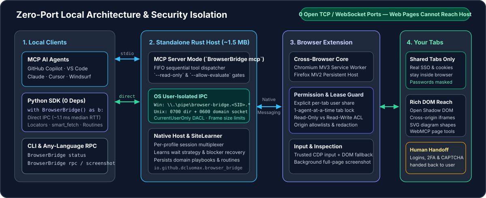

# Architecture Deep Dive

  

Browser Bridge is structured as a compact three-part workspace with zero runtime dependencies outside the browser itself.

---

## 1. Rust Workspace (`rust/`)

Compiled with `opt-level = "s"`, `lto = true`, `codegen-units = 1`, and `strip = true`, producing a single **~1.5 MB** native executable (`BrowserBridge` / `BrowserBridge.exe`) consuming ~8 MB resident working set at runtime.

### `crates/bridge-core`
- **`native_messaging.rs`:** Implements length-prefixed 32-bit native-endian browser Native Messaging framing with strict payload size bounds.
- **`pipes.rs`:** Platform-specific local IPC server & discovery:
  - **Windows:** Win32 `CreateNamedPipeW` with explicit SDDL Security Descriptor (`CurrentUserOnly` DACL + `FILE_FLAG_FIRST_PIPE_INSTANCE` on the first pipe instance) keyed by current process token SID.
  - **Unix (macOS / Linux):** Per-UID `0700` runtime directory (`$XDG_RUNTIME_DIR/browser-bridge` or `/tmp/bb-<uid>`) and `0600` Unix domain sockets with `uid` ownership verification.
- **`client.rs`:** Async multiplexer connecting MCP/CLI/SDK callers to one or more connected browser instances, supporting selector matching by browser kind (`edge`, `chrome`, `firefox`), profile `label` (`Work`), or 12-char `instanceId`.
- **`http.rs`:** Cookie-free `ureq` + native-TLS HTTP client with streaming byte-limit enforcement (`maxBytes` up to 32 MiB).
- **`routines.rs`:** `SiteLearner`, `SiteAccessProfile`, `LearnedRecoveryRule`, and parameterized multi-step `RoutineDefinition` execution engine.

### `crates/browser-bridge`
- **Dual-mode entrypoint (`main.rs`):** Automatically detects whether it was spawned by a browser (`chrome-extension://...` or Firefox manifest path + add-on ID) versus launched by a user/MCP client (`mcp`, `rpc`, `status`, `screenshot`, `routines`, `mcp-mode`, `install`, `uninstall`).
- **Sequential MCP Dispatcher (`mcp.rs`):** Routes stateful `tools/call` requests through an ordered FIFO worker channel so batched model tool calls execute deterministically in sequence while keeping `ping` and metadata queries non-blocking.
- **Native Host Multiplexer (`native_host.rs`):** Bridges multiple concurrent local IPC sessions over a single browser Native Messaging pipe, tagging each session (`session: open/close`) so tab leases release cleanly the instant an MCP client or script exits.

---

## 2. Browser Extension (`extension/`)

Bundled with `esbuild` from a shared TypeScript + React 19 codebase into two browser-native targets:

- **Chromium Target (`dist/chromium`, Manifest V3):** Service worker (`background.js`), pinned public manifest key (`bridge.config.json`) so unpacked installs always derive a deterministic 32-character extension ID matching `allowed_origins`.
- **Firefox Target (`dist/firefox`, Manifest V2):** Persistent background script (`persistent: true`) so Firefox keeps the Native Messaging stdio port open continuously without MV3 event-page disconnects.
- **On-Demand Content Engine (`content.ts`):** Lazily injected into authorized frames via `scripting.executeScript` with version handshake (`EXPECTED_CONTENT_VERSION`) so the first snapshot/locator call executes in 1 RTT and zero idle overhead runs on unshared tabs.
- **Trusted Input vs DOM Events (`cdp.ts` + `content.ts`):** Chromium tabs use `chrome.debugger` (`Input.dispatchMouseEvent`, `Input.dispatchKeyEvent`, `Page.captureScreenshot`, `DOM.setFileInputFiles`) by default and gracefully degrade to synthesized DOM/Pointer/Keyboard events whenever debugger attachment is disabled or unsupported (such as cross-origin subframes or Firefox).
