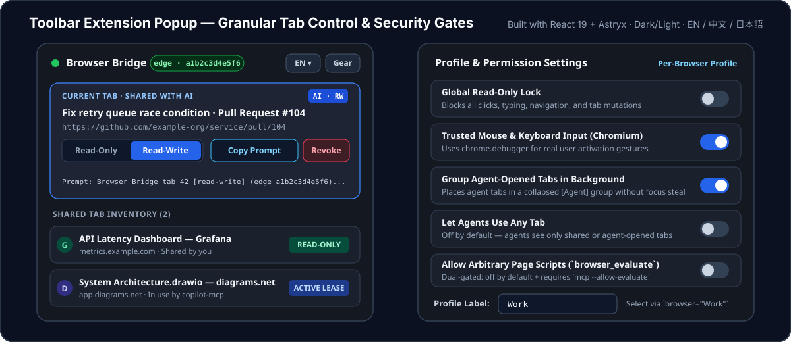

# Browser Extension Guide

<p align="center">
  
</p>

The Browser Bridge extension is built with TypeScript, React 19, and the Astryx neutral theme. A single codebase compiles cleanly to **Chromium Manifest V3** (Edge, Chrome, Brave, Chromium) and **Firefox Manifest V2** (persistent background page keeping the Native Messaging pipe alive).

---

## Toolbar Badges & Visual States

| Badge / Dot | Meaning |
| --- | --- |
| **Green dot** on toolbar icon | Native Messaging host (`BrowserBridge`) is connected and healthy |
| **`AI` (Green badge)** | Tab is shared in **Read-Only** mode |
| **`AI` (Blue badge)** | Tab is shared in **Read-Write** mode |
| **Indigo active indicator** | An agent command is actively executing on this tab |
| **Amber indicator** | Tab is waiting for human handoff (e.g., login, 2FA, or user demonstration) |

---

## Sharing Tabs & Switching Access Modes

You have two fast ways to share or revoke a tab:

1. **Toolbar Popup:**
   - Click the Browser Bridge icon to view the current tab card and the **Shared Tab Inventory**.
   - Share in **Read-Only** or **Read-Write** mode, toggle modes anytime with one click, click **Copy Prompt**, or click **Revoke / Stop Sharing**.
2. **Right-Click Context Menu:**
   - Right-click any page, text selection, or hyperlink → **Browser Bridge**:
     - **Share Read-Only & Copy Prompt**
     - **Share Read-Write & Copy Prompt**
     - **Share & Focus on Selection / Link** (embeds your highlighted text or target link directly into the copied 1-line Agent Prompt!)
     - **Switch Read-Only / Read-Write**
     - **Stop Sharing Tab**
     - **Save Viewport / Full-Page Screenshot to Downloads**

---

## Profile Settings Explained

- **Global Read-Only Lock** *(Off by default)* — Immediately blocks all mutating operations across every tab in this browser profile, even on tabs previously granted `Read-Write`.
- **Trusted Mouse & Keyboard Input** *(On by default, Chromium only)* — Uses `chrome.debugger` so clicks, drags, and key presses carry genuine browser user activation (`event.isTrusted === true`). While attached, Chromium shows its *"started debugging this browser"* banner; dismissing the banner detaches cleanly and falls back to DOM events.
- **Group Agent-Opened Tabs** *(On by default, Chromium only)* — Places background tabs created by agents into a collapsed `[Agent]` tab group so your tab strip stays tidy.
- **Let Agents Use Any Tab** *(Off by default)* — Keep this **off** for normal daily work so only explicitly shared or agent-created tabs are accessible.
- **Allow Agents to Run Page Scripts** *(Off by default)* — Second gate required for `browser_evaluate` (in addition to starting `BrowserBridge mcp --allow-evaluate`).
- **Profile Label** — Assign a memorable name such as `Work`, `Personal`, or `Staging`. Agents and scripts can then target this exact profile via `browser="Work"`.
- **Language & Theme** — Switch instantly among `Auto`, `English`, `简体中文`, `繁體中文`, and `日本語`, as well as Light and Dark themes.

---

## Reload Persistence & Permanent Firefox Signing

- **Origin-Verified Grant Persistence:** User-shared tab grants are saved in `storage.local` keyed by `(tabId, origin)`. Reloading the extension after running `install.ps1` / `install.sh` restores your shared tabs automatically as long as they have not navigated to a different origin.
- **Signing for Release Firefox:** Standard Release Firefox clears unsigned temporary add-ons on browser restart. To install permanently in Firefox, generate Mozilla Add-ons (AMO) API credentials and run:
  ```bash
  cd extension
  WEB_EXT_API_KEY="..." WEB_EXT_API_SECRET="..." npm run sign:firefox
  ```
  Install the signed unlisted `.xpi` generated under `extension/dist/signed/`.
