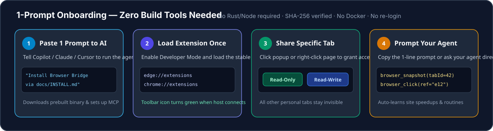

# Getting Started

<p align="center">
  
</p>

Follow these four steps to go from a fresh clone to reading and automating a live browser tab in under 60 seconds.

---

## Prerequisites

- **Rust** `1.85+` ([rustup.rs](https://rustup.rs))
- **Node.js** `20+` and `npm`
- *(Optional)* **Python** `3.10+` for the zero-dependency Python SDK

---

## Step 1: Run the One-Line Installer

### Windows (PowerShell)

```powershell
git clone https://github.com/dcluomax/browser-bridge.git
cd browser-bridge
.\scripts\install.ps1 -RegisterAllMcp -InstallPythonSdk
```

### macOS & Linux

```bash
git clone https://github.com/dcluomax/browser-bridge.git
cd browser-bridge
./scripts/install.sh --register-all --install-python
```

What the installer does:
1. Bundles the Chromium (Manifest V3) and Firefox (Manifest V2) extensions into `extension/dist/`.
2. Compiles the standalone release binary (`BrowserBridge` / `BrowserBridge.exe`, ~1.5 MB).
3. Copies the binary and unpacked extensions into a stable per-user home (`%LOCALAPPDATA%\BrowserBridge` on Windows, `~/.browser-bridge` on macOS/Linux).
4. Registers per-user Native Messaging manifests for Edge, Chrome, Chromium, and Firefox.
5. Registers the `browser-bridge` MCP server in GitHub Copilot, Claude Desktop, and Cursor configs (when `-RegisterAllMcp` / `--register-all` is passed).

---

## Step 2: Load the Extension Once

| Browser | Instructions |
| --- | --- |
| **Microsoft Edge** | Visit `edge://extensions` → Turn on **Developer mode** → Click **Load unpacked** → Select `%LOCALAPPDATA%\BrowserBridge\extension\chromium` (or `~/.browser-bridge/extension/chromium`) |
| **Google Chrome / Brave** | Visit `chrome://extensions` → Turn on **Developer mode** → Click **Load unpacked** → Select the `chromium` folder above |
| **Mozilla Firefox** | Visit `about:debugging#/runtime/this-firefox` → Click **Load Temporary Add-on...** → Select `extension/firefox/manifest.json` |

Verify the connection:

```bash
# Windows
"%LOCALAPPDATA%\BrowserBridge\app\BrowserBridge.exe" status

# macOS / Linux
~/.browser-bridge/app/BrowserBridge status
```

You should see your running browser listed under `Connected browsers:` and a **green status dot** on the Browser Bridge toolbar icon.

---

## Step 3: Share One Tab

1. Open any tab you want your AI assistant to inspect or interact with.
2. Click the **Browser Bridge** toolbar button (or right-click anywhere on the page → **Browser Bridge**).
3. Choose **Read-Only** (inspection & screenshots only) or **Read-Write** (clicks, forms & navigation).

All other tabs in your browser remain invisible to AI sessions.

---

## Step 4: Prompt Your AI Agent or Python Script

Click **Copy Prompt** in the popup to copy a ready-to-paste handle, or simply ask your MCP client:

> *"Check my shared browser tab with `browser_snapshot` and summarize the page."*

Next: explore [[Browser Extension Guide]], [[MCP Client Setup]], and [[MCP Tools Reference]].
