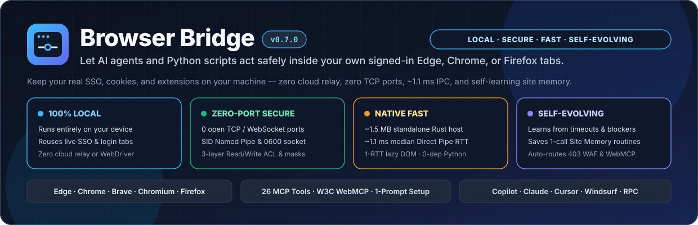
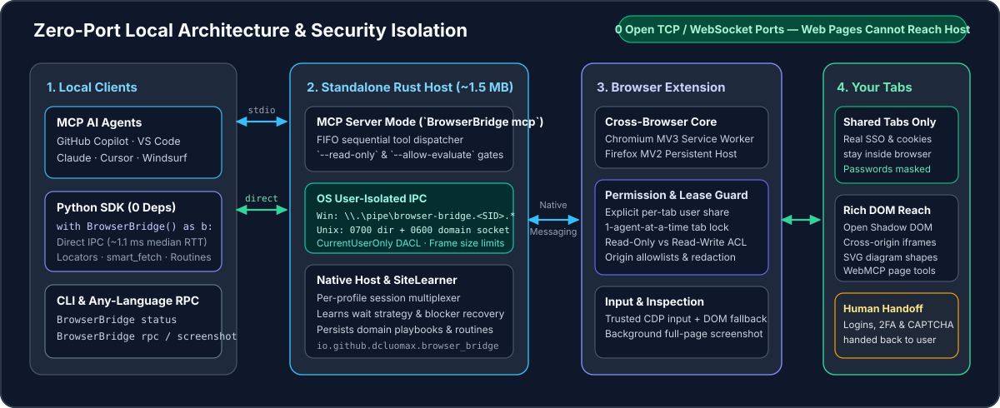

  

Welcome to the official **Browser Bridge Wiki**!

**Browser Bridge** connects local AI coding agents (GitHub Copilot, Claude Desktop / Claude Code, Cursor, Windsurf, Cline, and any MCP client) and local Python scripts directly to **your own signed-in Microsoft Edge, Google Chrome, Brave, or Mozilla Firefox tabs** — with zero open TCP ports, explicit per-tab user consent, and automatic per-domain performance learning.

---

## Quick Navigation

| Section | Pages |
| --- | --- |
| **Start Here** | [[Getting Started]] · [[Browser Extension Guide]] · [[MCP Client Setup]] |
| **Tools, Routines & SDK** | [[MCP Tools Reference]] · [[Site Memory and WebMCP]] · [[Python SDK and Local IPC]] |
| **Architecture & Security** | [[Architecture Deep Dive]] · [[Security and Privacy Model]] |
| **Operations & Development** | [[CLI and Troubleshooting]] · [[Contributing and Development]] |

---

## System Overview

  

### Four Core Pillars: Local · Secure · FAST · Self-Evolving

1. **100% LOCAL — Your Real Browser & SSO:** Zero cloud relays, zero remote containers, and zero browser driver downloads. Sign in once in your normal browser and share only the specific tab you want an agent to read or assist with.
2. **ZERO-PORT SECURE — OS Isolation & 3-Layer ACLs:** Communication uses OS-enforced `CurrentUserOnly` Windows Named Pipes (`\\.\pipe\browser-bridge.<SID>.*`) and `0700`/`0600` Unix Domain Sockets — never localhost HTTP or WebSocket ports — backed by `--read-only`, Global Read-Only Lock, per-tab `Read-Only`/`Read-Write` grants, and automatic credential redaction.
3. **NATIVE FAST — ~1.5 MB Rust Binary & ~1.1 ms IPC:** Standalone native Rust host (~8 MB RAM) paired with a zero-dependency Python SDK over direct OS pipes (`~1.1 ms` median RTT), 1-RTT lazy DOM snapshots, and background focus-free screenshots.
4. **SELF-EVOLVING — `SiteLearner`, Routines & WebMCP:** Automatically turns first-visit timeouts, SPA hydration races, overlay blockers, and `403` WAF blocks into sub-second domain playbooks, reusable 1-call routines, and W3C `document.modelContext` WebMCP tool calls.
