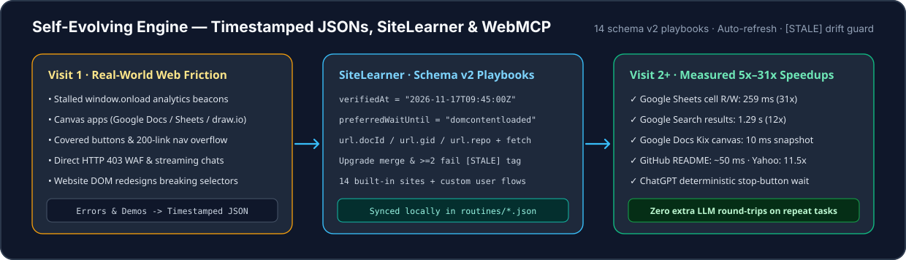

# Site Memory and WebMCP

<p align="center">
  
</p>

Browser Bridge goes beyond stateless DOM clicking with two complementary acceleration layers: **Adaptive Site Memory (`SiteLearner` + `Routines`)** and **Native W3C WebMCP (`document.modelContext`)**.

---

## 1. Adaptive Error-Driven Site Learning (`SiteLearner`)

Whenever an agent or Python script interacts with a non-loopback domain, `SiteLearner` in `bridge-core` tracks real execution outcomes and persists verified optimizations in `<data_dir>/routines/<domain>.json`:

1. **Stalled Beacon Bypass (`preferredWaitUntil="domcontentloaded"`):** When a page's `DOMContentLoaded` fires quickly (`< 1.5s`) while third-party analytics/ad beacons stall `window.onload` into timeouts or multi-second tails, `SiteLearner` upgrades future navigations on that domain to `domcontentloaded`.
2. **SPA Hydration Stabilization (`hydrationSettleMs`):** When early `stale_ref` or `not_ready` errors occur immediately after client-side routing or React/Next/Vue hydration, `SiteLearner` applies a bounded post-navigation settle window.
3. **Blocker Recovery Triads (`LearnedRecoveryRule`):** When an action fails with `not_actionable: covered by <div#cookie-wall>`, the agent clicks `#accept-cookies`, and the retried target click succeeds, `SiteLearner` records the verified `(blocker, recoveryMethod, recoveryTarget)` triad and surfaces it automatically in future snapshots.
4. **Input Transport Fallback (`preferredInput="dom"`):** If enterprise browser policy blocks `chrome.debugger`, `SiteLearner` remembers to use direct DOM events (with a 24-hour TTL) instead of retrying debugger attachment on every click.
5. **WAF Session Routing (`directHttpBlocked`):** When anonymous host HTTP (`request.fetch`) hits `403` / `429` while in-tab `page.fetch` succeeds, `browser.smart_fetch` routes subsequent requests on that domain directly through the authenticated tab.

Inspect or reset any domain's learned profile from the CLI:

```bash
BrowserBridge routines example.com
BrowserBridge routines example.com --json
BrowserBridge routines example.com --reset-profile
```

---

## 2. Timestamped Site Optimization JSONs (`routines/*.json`, `schemaVersion: 2`)

A **Routine** collapses a 5–10 step UI interaction into a single deterministic tool call (`browser_routine_run` in MCP or `page.run_routine(...)` in Python).

### Built-In 14-Site Timestamped Playbooks (`v0.10.0`)

Browser Bridge ships **14 standalone, git-tracked JSON playbooks** in [`routines/*.json`](https://github.com/dcluomax/browser-bridge/tree/main/routines), each carrying ISO-8601 UTC `verifiedAt` and `updatedAt` timestamps plus `speedupSummary`:

- **Upgrade Auto-Merge:** When upgrading Browser Bridge, built-in routines whose `verifiedAt` is newer than an older local cache's `updatedAt` refresh automatically while keeping custom user routines, learned pitfalls, and notes untouched.
- **Website-Redesign Drift Detection (`[STALE]`):** After `>= 2` consecutive selector or timeout failures on a routine, Browser Bridge flags it `[STALE - DOM may have changed]` with `staleReason` so agents inspect `browser_snapshot` and save updated selectors.
- **Path-Scoped Apps, Aliases & Dynamic URL Variables:** Distinguishes `docs.google.com/document` vs `docs.google.com/spreadsheets`, resolves friendly aliases (`google-docs`, `google-sheets`, `google-excel`, `chatgpt`, `drawio`, `hn`), supports `op: "fetch"` (`stripHtml`), `{{param:urlencode}}`, and injects `{{url.docId}}`, `{{url.gid}}`, `{{url.repo}}`, and `{{url.origin}}`.

| Playbook JSON | Built-in Routines | Measured Speedup |
| --- | --- | --- |
| `google.com.json` | `search`, `read_results`, `next_results_page` | `15,495 ms` → **`1,292–1,423 ms` (~11–12×)** |
| `docs.google.com__document.json` | `read_document`, `append_text`, `replace_text`, `rename_document` | `8,218 ms` → **`1,528 ms` (5.4×)** + **`10 ms`** Kix `<canvas>` snapshot + **`~170–267 ms`** `/mobilebasic` |
| `docs.google.com__spreadsheets.json` | `read_sheet_csv`, `read_cell`, `write_cell`, `select_range`, `rename_spreadsheet` | `8,077 ms` → **`259 ms` (31×)** cell R/W + **`~201–325 ms`** `/gviz/tq` CSV |
| `github.com.json` | `read_main_content`, `search_github`, `search_repo_issues`, `go_to_file` | `3,469 ms` → **`~920 ms` (3.8×)** + **`~50 ms`** README/PR extraction |
| `chatgpt.com.json` | `draft_prompt`, `ask_and_wait`, `read_conversation`, `new_chat` | **`~690–914 ms`** ready + **`117 ms`** safe draft + deterministic `stop-button` wait |
| `diagrams.net.json` | `read_diagram_xml`, `write_diagram_xml`, `insert_shape`, `add_page` | `#fragment` `30s` timeout → `4.96 s`; **`660 ms`** XML read / **`870 ms`** write |
| `amazon.com.json` | `search_products`, `read_product_details` | `16,043 ms` → **`2,491 ms` (6.4×)** |
| `finance.yahoo.com.json` | `lookup_quote`, `read_quote_summary` | `8,050 ms+` → **`702 ms` (11.5×)** |
| `youtube.com.json` | `search_videos`, `open_transcript` | **`2,042 ms`** video search (avoids 30s streaming `onload` stall) |
| `wikipedia.org.json` | `search_article`, `read_article` | ~8 KB `#cite_note` compaction + 35k-char article read in **`~2.2 s`** |
| `news.ycombinator.com.json` | `read_front_page`, `search_hn` | Flattens `border=0` layout tables; 30/30 stories untruncated |
| `stackoverflow.com.json` | `dismiss_cookies`, `search_questions`, `read_qa` | OneTrust auto-dismiss + 1,200-char code blocks + **`~60 ms`** Q&A read |
| `reddit.com.json` | `search_reddit`, `read_thread` | `directHttpBlocked=true` (`403` skip) + `shreddit-*` Shadow DOM traversal |
| `x.com.json` | `search_posts`, `draft_post` | `domcontentloaded` + `350 ms` hydration + Cloudflare `browser_handoff` detection |

### Defining Custom Domain Routines
Agents (or users) can save reusable routines via `browser_routine_save`:

```json
{
  "domain": "issues.example.com",
  "routine": {
    "name": "filter_open_bugs",
    "description": "Filters the issue table by query text and returns matching titles",
    "readOnly": false,
    "params": {
      "query": { "type": "string", "required": true, "description": "Search filter text" }
    },
    "steps": [
      {
        "op": "type",
        "params": {
          "locator": { "steps": [{ "kind": "placeholder", "value": "Filter issues" }] },
          "text": "{{query}}",
          "clear": true,
          "submit": true
        }
      },
      {
        "op": "waitFor",
        "params": {
          "locator": { "steps": [{ "kind": "css", "value": ".issue-row" }] },
          "state": "visible"
        }
      },
      {
        "op": "queryAll",
        "params": {
          "locator": { "steps": [{ "kind": "css", "value": ".issue-row .title" }] },
          "operation": "innerText"
        },
        "saveAs": "titles"
      }
    ]
  }
}
```

---

## 3. Native W3C WebMCP (`document.modelContext`)

Web applications adopting the emerging **WebMCP** standard register structured tools directly in page JavaScript (`navigator.modelContext.registerTool` / `document.modelContext.registerTool`) or declarative HTML forms (`<form toolname="search_docs" tooldescription="...">`).

Browser Bridge injects a zero-privilege collector at `document_start` across **Edge, Chrome, and Firefox**:
- Call `browser_webmcp_list` to inspect available page tools, JSON input schemas, and `readOnlyHint` / `consequentialHint` flags.
- Call `browser_webmcp_call({ "name": "...", "arguments": { ... } })` to invoke the page's structured tool directly without brittle DOM scraping.
- When a tab or MCP server is in `Read-Only` mode, Browser Bridge refuses any WebMCP tool that does not declare `readOnlyHint: true`.
